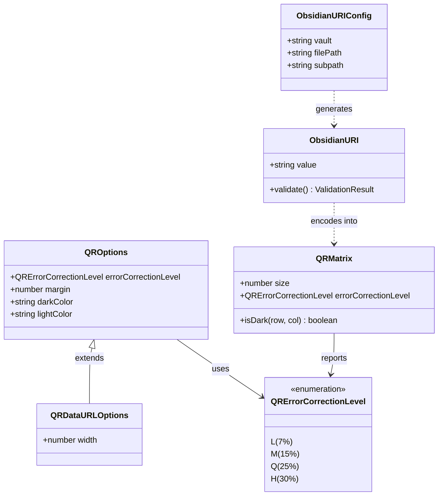

# Data Model: Obsidian URI Generation & QR Encoding

**Feature**: `specs/002-obsidian-uri-qr`  
**Date**: 2026-10-03  
**Status**: Completed

## 1. Domain Entities & Value Objects

---

## 2. Entity Specifications

### 2.1 `ObsidianURIConfig`
Represents the input parameters required to construct a standard Obsidian URI.

| Field | Type | Required | Default | Validation & Rules |
|---|---|---|---|---|
| `vault` | `string` | Yes | - | Must be a non-empty string. Stripped of leading/trailing whitespace. Must not be blank. |
| `filePath` | `string` | Yes | - | Must be a non-empty string. Leading slashes (`/` or `\`) are stripped. Relative to vault root. |
| `subpath` | `string` | No | `undefined` | Optional anchor: `#Heading` or `^block-id`. If provided, must start with `#` or `^`. |

### 2.2 `ObsidianURI`
The resulting canonical URI string.

- **Type**: `string` (Value Object)
- **Format**: `obsidian://open?vault=<encodedVault>&file=<encodedFile>`
- **Encoding Standard**: RFC 3986 percent-encoding for query parameter values.
  - Slashes (`/`) in `file` encoded as `%2F`.
  - Spaces encoded as `%20`.
  - Characters `!`, `'`, `(`, `)`, `*` percent-encoded.
  - Unicode encoded as UTF-8 percent-sequences (e.g. `ü` → `%C3%BC`).
- **Invariance**: Must always start with `obsidian://open?`.

### 2.3 `QRErrorCorrectionLevel`
Reed-Solomon recovery level for optical scanning resilience.

| Value | Recovery Capacity | Intended Use Case |
|---|---|---|
| `'L'` | ~7% recovery | High-density information on large, clean labels |
| `'M'` | ~15% recovery | **Default** - optimal balance of density and resilience |
| `'Q'` | ~25% recovery | Commercial asset tags subject to moderate abrasion |
| `'H'` | ~30% recovery | Outdoor, workshop, high-wear tags subject to scratching/dirt |

### 2.4 `QROptions`
Configuration governing QR matrix layout and module representation.

| Field | Type | Required | Default | Validation & Rules |
|---|---|---|---|---|
| `errorCorrectionLevel` | `QRErrorCorrectionLevel` | No | `'M'` | Must be one of `'L'`, `'M'`, `'Q'`, `'H'`. |
| `margin` | `number` | No | `1` | Integer >= 0. Number of quiet-zone modules bordering the symbol. |
| `darkColor` | `string` | No | `'#000000'` | Valid hex color or recognized CSS color for dark modules. |
| `lightColor` | `string` | No | `'#FFFFFF'` | Valid hex, recognized CSS color, or `'transparent'`. |

### 2.5 `QRDataURLOptions`
Extends `QROptions` for generating standalone raster preview images.

| Field | Type | Required | Default | Validation & Rules |
|---|---|---|---|---|
| `width` | `number` | No | `256` | Integer > 0. Pixel dimension for generated square PNG. |

### 2.6 `QRMatrix`
In-memory two-dimensional grid of boolean modules ready for rendering.

| Property / Method | Type | Description |
|---|---|---|
| `size` | `number` | Number of modules along one axis ($N \times N$, e.g., 29, 33, 37). |
| `isDark(row, col)` | `(row: number, col: number) => boolean` | Returns true if the module at (row, col) is dark. Out-of-bounds returns false. |
| `errorCorrectionLevel` | `QRErrorCorrectionLevel` | The actual error correction level encoded in the matrix. |

---

## 3. Validation Rules & Diagnostic Error Codes

| Error Code | Field | Condition | Diagnostic Message |
|---|---|---|---|
| `EMPTY_VAULT` | `vault` | `!vault || vault.trim().length === 0` | "Vault name must not be empty." |
| `INVALID_VAULT_TYPE` | `vault` | `typeof vault !== 'string'` | "Vault name must be a string." |
| `EMPTY_FILE_PATH` | `filePath` | `!filePath || filePath.trim().length === 0` | "File path must not be empty." |
| `INVALID_FILE_PATH_TYPE` | `filePath` | `typeof filePath !== 'string'` | "File path must be a string." |
| `INVALID_SUBPATH` | `subpath` | `subpath && !subpath.startsWith('#') && !subpath.startsWith('^')` | "Subpath must begin with '#' for headings or '^' for block IDs." |
| `INVALID_EC_LEVEL` | `errorCorrectionLevel` | `!['L','M','Q','H'].includes(level)` | "Error correction level must be one of: L, M, Q, H." |
| `INVALID_QR_MARGIN` | `margin` | `typeof margin !== 'number' || margin < 0 || !Number.isInteger(margin)` | "QR margin must be a non-negative integer." |
| `INVALID_QR_WIDTH` | `width` | `width !== undefined && (typeof width !== 'number' || width <= 0)` | "QR width must be a positive integer." |
