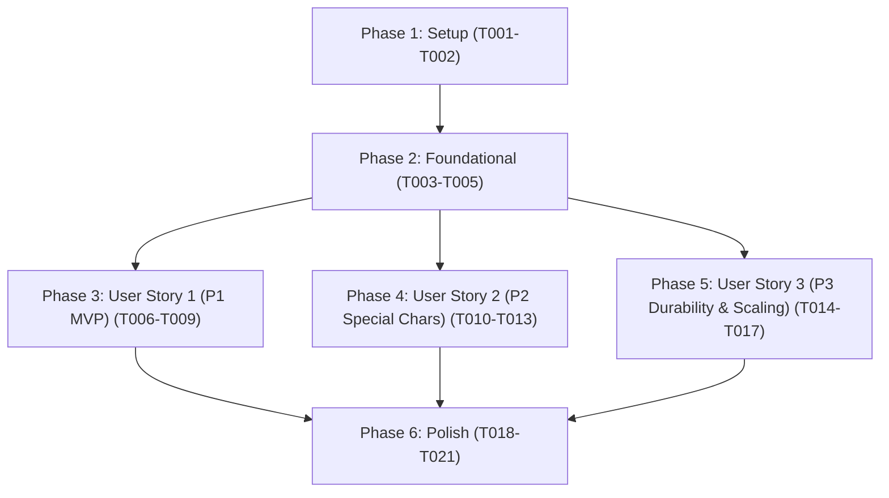

# Tasks: Obsidian URI Generation & QR Encoding

**Branch**: `002-obsidian-uri-qr` | **Date**: 2026-10-03 | **Spec**: [spec.md](./spec.md) | **Plan**: [plan.md](./plan.md)

---

## Phase 1: Setup (Shared Infrastructure)

**Purpose**: Verify dependencies and align contracts for URI and QR operations.

- [x] T001 Verify project dependencies and environment for qrcode and obsidian types in package.json
- [x] T002 [P] Align interface contracts in specs/002-obsidian-uri-qr/contracts/uri-generator.ts and specs/002-obsidian-uri-qr/contracts/qr-encoder.ts

---

## Phase 2: Foundational (Blocking Prerequisites)

**Purpose**: Core type definitions and validation infrastructure required before any user story implementation.

**⚠️ CRITICAL**: Must complete before user story implementation can proceed.

- [x] T003 Update core type definitions with ObsidianURIConfig, QRDataURLOptions, and enhanced QROptions in src/core/types.ts
- [x] T004 Implement URI configuration validation and QR option validation in src/core/validator.ts
- [x] T005 [P] Implement unit tests for URI and QR validation rules in tests/unit/validator.test.ts

**Checkpoint**: Core types and validation foundation verified; user story implementation can begin.

---

## Phase 3: User Story 1 - Standard Obsidian URI Generation & Optical QR Encoding (Priority: P1) 🎯 MVP

**Goal**: Generate standard `obsidian://open?vault=<vault>&file=<path>` URIs (using Obsidian's `app.getObsidianUrl` in-app with RFC fallback) and encode them into optical QR code matrices for canvas rendering.

**Independent Test**: Provide vault `"Personal"` and note path `"Workshop/Tools/Multimeter.md"`; verify generated URI is `obsidian://open?vault=Personal&file=Workshop%2FTools%2FMultimeter.md` and generates a valid QR matrix that renders onto canvas.

### Tests for User Story 1

- [x] T006 [P] [US1] Create unit tests for standard URI generation and root-level note paths in tests/unit/uri.test.ts
- [x] T007 [P] [US1] Create unit tests for QR matrix generation with default Level M in tests/unit/qr.test.ts

### Implementation for User Story 1

- [x] T008 [US1] Implement generateObsidianURI and generateNativeObsidianURI with app.getObsidianUrl fallback in src/core/uri.ts
- [x] T009 [US1] Integrate URI generation with label content pipeline in src/core/label-generator.ts

**Checkpoint**: User Story 1 MVP fully functional and testable independently.

---

## Phase 4: User Story 2 - Resilient Encoding with Special Characters & Vault Names with Spaces (Priority: P2)

**Goal**: Support robust RFC 3986 percent-encoding across spaces, ampersands, punctuation, Unicode characters, and deeply nested paths without double-encoding slashes or query parameters.

**Independent Test**: Provide vault `"Work & Life"` and note `"Projects/C++ & Rust/Notes 2026.md"` or Unicode note `"München/Reiseführer 🇩🇪.md"`; verify exact RFC percent-encoding and scanning integrity.

### Tests for User Story 2

- [x] T010 [P] [US2] Create unit tests for special characters, spaces, and Unicode paths in tests/unit/uri.test.ts
- [x] T011 [P] [US2] Create unit tests for deeply nested directory paths and optional subpaths (#Heading, ^blockid) in tests/unit/uri.test.ts

### Implementation for User Story 2

- [x] T012 [US2] Implement RFC 3986 parameter escaping and path normalizer in src/core/uri.ts
- [x] T013 [US2] Add subpath anchor validation and formatting support in src/core/uri.ts

**Checkpoint**: User Stories 1 and 2 functional and independently verified.

---

## Phase 5: User Story 3 - Configurable QR Durability & Optical Scaling (Priority: P3)

**Goal**: Support selectable QR error correction levels (L, M, Q, H), quiet-zone margins (>= 1 module), custom dark/light contrast colors, and async raster Base64 data URL exports.

**Independent Test**: Generate a QR code with Error Correction Level H and custom contrast; verify matrix density increases to 30% recovery, quiet zone is applied, and data URL decodes back to the URI.

### Tests for User Story 3

- [x] T014 [P] [US3] Create unit tests for selectable error correction levels (L, M, Q, H) and matrix sizes in tests/unit/qr.test.ts
- [x] T015 [P] [US3] Create unit tests for async Base64 data URL generation and contrast colors in tests/unit/qr.test.ts

### Implementation for User Story 3

- [x] T016 [US3] Implement async generateQRDataURL supporting width, errorCorrectionLevel, margin, and color styling in src/core/qr.ts
- [x] T017 [US3] Enhance drawQRMatrix to support configurable margin quiet-zone in src/core/qr.ts

**Checkpoint**: All three user stories functional, meeting all durability and visual contrast requirements.

---

## Phase 6: Polish & Cross-Cutting Concerns

**Purpose**: System integration, exports, documentation, and end-to-end verification.

- [x] T018 [P] Re-export URI utilities and new QR functions in src/index.ts
- [x] T019 Run full quickstart validation scenarios from specs/002-obsidian-uri-qr/quickstart.md
- [x] T020 [P] Run linter and formatting checks across all source and test files with npm run lint
- [x] T021 Verify zero TypeScript compilation errors with npx tsc --noEmit and execute full test suite with npm test

---

## Dependencies & Execution Order

### Phase Dependencies



- **Phase 1 (Setup)**: Can start immediately.
- **Phase 2 (Foundational)**: Depends on Phase 1; blocks all user stories.
- **Phase 3 (User Story 1 - P1 MVP)**: Depends on Phase 2; deliverable on its own.
- **Phase 4 (User Story 2 - P2)**: Depends on Phase 2; enhances URI encoding routines.
- **Phase 5 (User Story 3 - P3)**: Depends on Phase 2; enhances QR generator routines.
- **Phase 6 (Polish)**: Depends on desired user stories being completed.

### Parallel Opportunities

- **Setup Phase**: T002 can run in parallel with T001.
- **Foundational Phase**: T005 can run in parallel with T003/T004 once types are defined.
- **User Story 1**: T006 and T007 tests can run in parallel.
- **User Story 2**: T010 and T011 tests can run in parallel.
- **User Story 3**: T014 and T015 tests can run in parallel.
- **Polish Phase**: T018 and T020 can run in parallel.

---

## Parallel Execution Examples

### User Story 1 Parallel Tasks

```bash
# Tests can be authored in parallel:
Task: "T006 [P] [US1] Create unit tests for standard URI generation and root-level note paths in tests/unit/uri.test.ts"
Task: "T007 [P] [US1] Create unit tests for QR matrix generation with default Level M in tests/unit/qr.test.ts"
```

### User Story 2 Parallel Tasks

```bash
# Tests for special characters and nested paths in parallel:
Task: "T010 [P] [US2] Create unit tests for special characters, spaces, and Unicode paths in tests/unit/uri.test.ts"
Task: "T011 [P] [US2] Create unit tests for deeply nested directory paths and optional subpaths (#Heading, ^blockid) in tests/unit/uri.test.ts"
```

### User Story 3 Parallel Tasks

```bash
# Tests for error correction levels and data URLs in parallel:
Task: "T014 [P] [US3] Create unit tests for selectable error correction levels (L, M, Q, H) and matrix sizes in tests/unit/qr.test.ts"
Task: "T015 [P] [US3] Create unit tests for async Base64 data URL generation and contrast colors in tests/unit/qr.test.ts"
```

---

## Implementation Strategy

### MVP First (User Story 1 Only)

1. Complete **Phase 1: Setup** (T001, T002).
2. Complete **Phase 2: Foundational** (T003, T004, T005).
3. Complete **Phase 3: User Story 1** (T006, T007, T008, T009).
4. **Validate MVP**: Run `npx jest tests/unit/uri.test.ts tests/unit/qr.test.ts` to prove standard Obsidian URI generation and optical QR rendering work end-to-end.

### Incremental Delivery

1. Foundation ready (T001–T005).
2. User Story 1 delivered (T006–T009) → Core MVP working.
3. User Story 2 delivered (T010–T013) → Spaces, symbols, and Unicode supported.
4. User Story 3 delivered (T014–T017) → Industrial durability (Level H), quiet zones, and data URLs supported.
5. Polish & Verification (T018–T021) → Re-exports, quickstart tests, and clean build.
