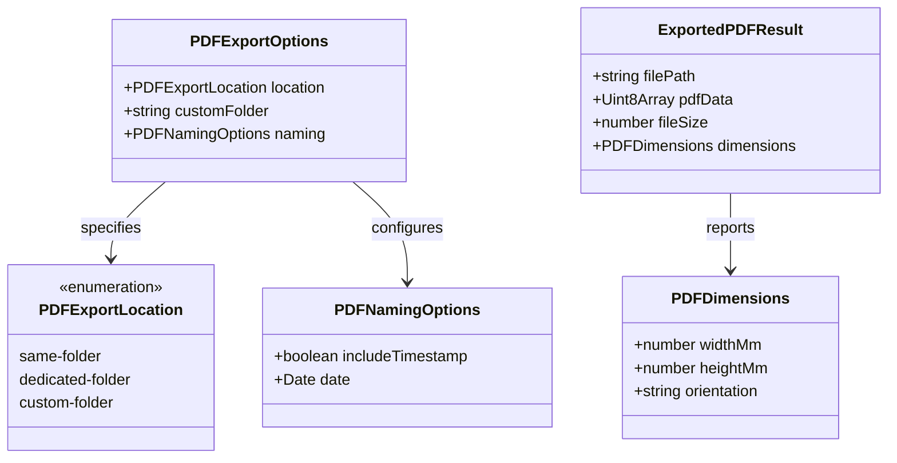

# Data Model: PDF Export for Physical Label Printing

**Feature**: `specs/003-pdf-export`  
**Date**: 2026-10-04  
**Status**: Completed

## 1. Domain Entities & Value Objects



---

## 2. Entity Specifications

### 2.1 `PDFExportLocation`
Enumeration governing the target storage destination within the Obsidian vault.

| Value | Behavior | Example Destination |
|---|---|---|
| `'same-folder'` | **Default** - saved adjacent to the source note in the same directory | Note: `Projects/Hardware.md` → `Projects/Hardware_label.pdf` |
| `'dedicated-folder'` | Saved to a central `_labels/` directory in the vault root | Note: `Projects/Hardware.md` → `_labels/Hardware_label.pdf` |
| `'custom-folder'` | Saved to a user-configured vault-relative folder | Note: `Projects/Hardware.md` → `PrintQueue/Pending/Hardware_label.pdf` |

### 2.2 `PDFNamingOptions`
Controls filename formatting and optional date stamping.

| Field | Type | Required | Default | Description |
|---|---|---|---|---|
| `includeTimestamp` | `boolean` | No | `false` | When true, appends `_YYYY-MM-DD` before the `.pdf` extension. Default `false` ensures clean overwrite. |
| `date` | `Date` | No | Current Date (`new Date()`) | The reference date to format when `includeTimestamp` is true. |

### 2.3 `PDFExportOptions`
Composite configuration governing PDF export location and naming.

| Field | Type | Required | Default | Description |
|---|---|---|---|---|
| `location` | `PDFExportLocation` | No | `'same-folder'` | Destination directory resolution strategy. |
| `customFolder` | `string` | No | `undefined` | Vault-relative path used when `location === 'custom-folder'`. |
| `naming` | `PDFNamingOptions` | No | `{ includeTimestamp: false }` | Filename construction options. |

### 2.4 `ExportedPDFResult`
Structured result returned upon successful PDF generation and storage.

| Field | Type | Description |
|---|---|---|
| `filePath` | `string` | Normalized vault-relative path where the PDF was written (e.g. `Equipment/Tool_label.pdf`). |
| `pdfData` | `Uint8Array` | Binary bytes of the generated PDF document. |
| `fileSize` | `number` | Byte count of the PDF document. |
| `dimensions` | `PDFDimensions` | Physical page dimensions (`widthMm`, `heightMm`) and page `orientation` (`'portrait'` or `'landscape'`). |

---

## 3. Minimal Vault Abstraction (`MinimalVault`)

Defines the required capabilities of an Obsidian Vault runtime for persistent PDF writing, decoupling the core logic from Electron/Node internals.

```typescript
export interface MinimalVaultAdapter {
  exists(normalizedPath: string): Promise<boolean>;
  writeBinary(normalizedPath: string, data: ArrayBuffer): Promise<void>;
  mkdir(folderPath: string): Promise<void>;
}

export interface MinimalVault {
  adapter: MinimalVaultAdapter;
}
```

---

## 4. Validation Rules & Diagnostic Error Codes

| Error Code | Field | Condition | Diagnostic Message |
|---|---|---|---|
| `EMPTY_NOTE_PATH` | `notePath` | `!notePath || notePath.trim().length === 0` | "Note path must not be empty." |
| `INVALID_LOCATION` | `location` | `!['same-folder','dedicated-folder','custom-folder'].includes(loc)` | "Storage location must be 'same-folder', 'dedicated-folder', or 'custom-folder'." |
| `MISSING_CUSTOM_FOLDER` | `customFolder` | `location === 'custom-folder' && (!customFolder || !customFolder.trim())` | "Custom folder path must be specified when location is set to 'custom-folder'." |
| `INVALID_DIMENSIONS` | `dimensions` | `widthMm <= 0 || heightMm <= 0` | "PDF page dimensions must be positive numbers." |
| `VAULT_WRITE_ERROR` | `filePath` | File I/O failure during vault write operation | "Failed to save PDF to vault at '{path}': {error}" |
