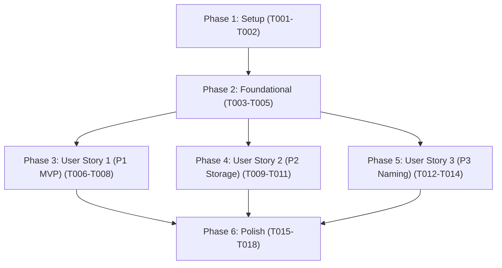

# Tasks: PDF Export for Physical Label Printing

**Branch**: `003-pdf-export` | **Date**: 2026-10-04 | **Spec**: [spec.md](./spec.md) | **Plan**: [plan.md](./plan.md)

---

## Phase 1: Setup (Shared Infrastructure)

**Purpose**: Verify dependencies and align interface contracts for PDF export and vault storage.

- [x] T001 Verify jsPDF dependency and type declarations in package.json
- [x] T002 [P] Align interface contracts in specs/003-pdf-export/contracts/pdf-exporter.ts and specs/003-pdf-export/contracts/vault-storage.ts

---

## Phase 2: Foundational (Blocking Prerequisites)

**Purpose**: Core type definitions and validation infrastructure required before implementing user stories.

**⚠️ CRITICAL**: Must complete before user story implementation can proceed.

- [x] T003 Define PDF export types (PDFExportLocation, PDFNamingOptions, PDFExportOptions, ExportedPDFResult, MinimalVault) in src/core/types.ts
- [x] T004 Implement export options validation rules in src/core/validator.ts
- [x] T005 [P] Create unit tests for export options validation in tests/unit/validator.test.ts

**Checkpoint**: Core types and validation foundation verified; user story implementation can begin.

---

## Phase 3: User Story 1 - Exact-Dimension Print-Ready PDF Generation (Priority: P1) 🎯 MVP

**Goal**: Generate exact-dimension, print-ready PDFs from rendered canvas surfaces with 0 margin offsets at 300+ DPI.

**Independent Test**: Export a 40mm x 30mm canvas to PDF; verify MediaBox and page properties report 40mm x 30mm in landscape with standard `%PDF-` header.

### Tests for User Story 1

- [x] T006 [P] [US1] Create unit tests for exact-dimension PDF generation and orientation in tests/unit/pdf-exporter.test.ts

### Implementation for User Story 1

- [x] T007 [US1] Enhance exportCanvasToPDF and exportCanvasToPDFBlob with orientation and dimension assertions in src/core/pdf-exporter.ts
- [x] T008 [US1] Integrate exportCanvasToPDF with RenderedLabel generation pipeline in src/core/label-generator.ts

**Checkpoint**: User Story 1 MVP fully functional and testable independently.

---

## Phase 4: User Story 2 - Configurable Vault Storage Locations (Priority: P2)

**Goal**: Support three vault storage location modes (`same-folder`, `dedicated-folder`, `custom-folder`), resolving paths accurately and recursively creating missing directories before writing.

**Independent Test**: Resolve paths for root and nested notes across all 3 modes; verify `savePDFToVault` creates missing folders and persists bytes.

### Tests for User Story 2

- [x] T009 [P] [US2] Create unit tests for storage destination path resolution and directory auto-creation in tests/unit/pdf-exporter.test.ts

### Implementation for User Story 2

- [x] T010 [US2] Implement resolveLabelPDFPath supporting same-folder, dedicated-folder, and custom-folder in src/core/pdf-exporter.ts
- [x] T011 [US2] Implement savePDFToVault with recursive folder creation and binary write in src/core/pdf-exporter.ts

**Checkpoint**: User Stories 1 and 2 functional and independently verified.

---

## Phase 5: User Story 3 - Flexible File Naming & Label Regeneration (Priority: P3)

**Goal**: Format filenames with `[NoteName]_label.pdf` by default, support optional `YYYY-MM-DD` date timestamps, and cleanly overwrite existing files on regeneration.

**Independent Test**: Generate filenames with and without timestamp; verify regeneration overwrites existing files without errors or file lock contention.

### Tests for User Story 3

- [x] T012 [P] [US3] Create unit tests for filename formatting, timestamp toggles, and regeneration overwriting in tests/unit/pdf-exporter.test.ts

### Implementation for User Story 3

- [x] T013 [US3] Implement generateLabelFilename supporting static default and optional date timestamp in src/core/pdf-exporter.ts
- [x] T014 [US3] Add exportLabelPDF convenience method to LabelGenerator in src/core/label-generator.ts

**Checkpoint**: All three user stories functional, meeting all location and naming requirements.

---

## Phase 6: Polish & Cross-Cutting Concerns

**Purpose**: System integration, exports, documentation, and end-to-end verification.

- [x] T015 [P] Re-export PDF export utilities and storage helpers in src/index.ts
- [x] T016 Create integration tests for Feature 003 quickstart scenarios in tests/integration/pdf-export.test.ts
- [x] T017 [P] Run linter and formatting checks across all source and test files with npm run lint
- [x] T018 Verify zero TypeScript compilation errors with npx tsc --noEmit and execute full test suite with npm test

---

## Dependencies & Execution Order

### Phase Dependencies

- **Phase 1 (Setup)**: Can start immediately.
- **Phase 2 (Foundational)**: Depends on Phase 1; blocks all user stories.
- **Phase 3 (User Story 1 - P1 MVP)**: Depends on Phase 2; deliverable on its own.
- **Phase 4 (User Story 2 - P2 Storage)**: Depends on Phase 2; adds path resolution and vault I/O.
- **Phase 5 (User Story 3 - P3 Naming)**: Depends on Phase 2; adds naming rules and regeneration.
- **Phase 6 (Polish)**: Depends on all user stories being completed.

### Parallel Opportunities

- **Setup Phase**: T002 can run in parallel with T001.
- **Foundational Phase**: T005 tests can run in parallel with T004 implementation.
- **User Story Phases**: T006, T009, and T012 tests can be authored in parallel.
- **Polish Phase**: T015 and T017 can run in parallel.

---

## Implementation Strategy

### MVP First (User Story 1 Only)

1. Complete **Phase 1: Setup** (T001, T002).
2. Complete **Phase 2: Foundational** (T003, T004, T005).
3. Complete **Phase 3: User Story 1** (T006, T007, T008).
4. **Validate MVP**: Run `npx jest tests/unit/pdf-exporter.test.ts -t "Exact Dimensions"` to prove exact millimeter PDF generation works end-to-end.

### Incremental Delivery

1. Foundation ready (T001–T005).
2. User Story 1 delivered (T006–T008) → Core MVP print-ready PDF export.
3. User Story 2 delivered (T009–T011) → In-vault storage modes & auto-directory creation.
4. User Story 3 delivered (T012–T014) → Static & timestamped naming + regeneration.
5. Polish & Verification (T015–T018) → Re-exports, integration tests, linting, and clean build.
