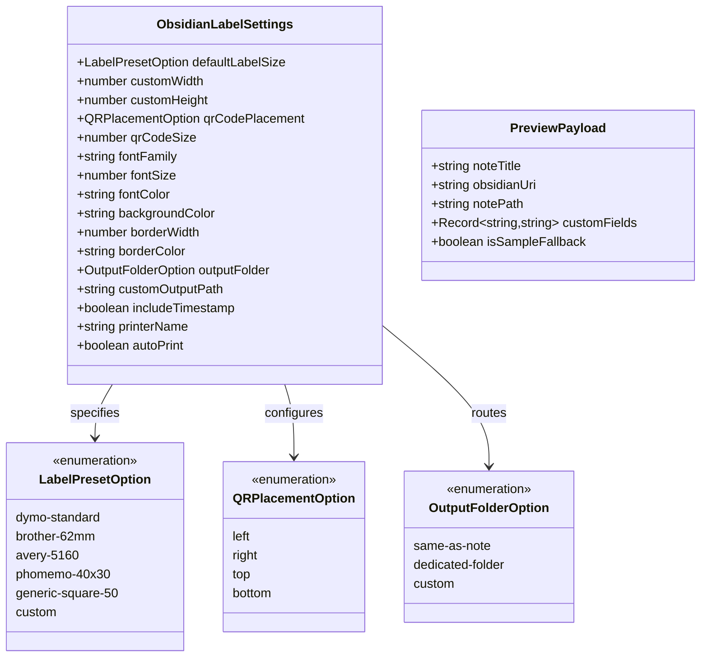

# Data Model: Plugin Settings Tab for Label Configuration

**Feature**: `specs/004-settings-tab`  
**Date**: 2026-10-05  
**Status**: Completed

## 1. Domain Entities & Value Objects



---

## 2. Entity Specifications

### 2.1 `ObsidianLabelSettings`
Persisted settings object stored in `.obsidian/plugins/obsidian-label/data.json`.

| Field | Type | Default | Description | Validation Rule |
|---|---|---|---|---|
| `defaultLabelSize` | `LabelPresetOption` | `'dymo-standard'` | Selected hardware preset or `'custom'` | Must be one of valid preset options |
| `customWidth` | `number` | `89` | Width in millimeters if custom | Must be positive number (`> 0`) |
| `customHeight` | `number` | `28` | Height in millimeters if custom | Must be positive number (`> 0`) |
| `qrCodePlacement` | `QRPlacementOption` | `'left'` | Relative spatial placement of QR | One of `'left'`, `'right'`, `'top'`, `'bottom'` |
| `qrCodeSize` | `number` | `25` | QR code proportion percentage | Integer between `10` and `50` |
| `fontFamily` | `string` | `'Arial'` | Font family for text rendering | Non-empty string |
| `fontSize` | `number` | `12` | Note title font size in points | Positive number (`> 0`) |
| `fontColor` | `string` | `'#000000'` | Typography fill color | Valid 3, 6, or 8-digit hex color |
| `backgroundColor` | `string` | `'#FFFFFF'` | Label background fill color | Valid hex color |
| `borderWidth` | `number` | `1` | Perimeter border stroke width in px | Non-negative integer (`>= 0`) |
| `borderColor` | `string` | `'#CCCCCC'` | Border stroke color | Valid hex color |
| `outputFolder` | `OutputFolderOption` | `'same-as-note'` | PDF target storage location | One of `'same-as-note'`, `'dedicated-folder'`, `'custom'` |
| `customOutputPath` | `string` | `'_labels'` | Vault path when custom folder active | Non-empty string |
| `includeTimestamp` | `boolean` | `false` | Append `_YYYY-MM-DD` to PDF filename | Boolean |
| `printerName` | `string` | `''` | Optional target printer identifier | String |
| `autoPrint` | `boolean` | `false` | Auto-send to printer flag | Boolean |

---

### 2.2 Default Configuration Constant (`DEFAULT_SETTINGS`)

```typescript
export const DEFAULT_SETTINGS: ObsidianLabelSettings = {
  defaultLabelSize: 'dymo-standard',
  customWidth: 89,
  customHeight: 28,
  qrCodePlacement: 'left',
  qrCodeSize: 25,
  fontFamily: 'Arial',
  fontSize: 12,
  fontColor: '#000000',
  backgroundColor: '#FFFFFF',
  borderWidth: 1,
  borderColor: '#CCCCCC',
  outputFolder: 'same-as-note',
  customOutputPath: '_labels',
  includeTimestamp: false,
  printerName: '',
  autoPrint: false,
};
```

---

### 2.3 Diagnostic Validation Rules

| Error Code | Field | Condition | Diagnostic Message |
|---|---|---|---|
| `INVALID_PRESET` | `defaultLabelSize` | Not in recognized preset list | "Label size preset must be a valid option." |
| `INVALID_CUSTOM_WIDTH` | `customWidth` | `customWidth <= 0 || isNaN(customWidth)` | "Custom width must be a positive number of millimeters." |
| `INVALID_CUSTOM_HEIGHT` | `customHeight` | `customHeight <= 0 || isNaN(customHeight)` | "Custom height must be a positive number of millimeters." |
| `INVALID_QR_PLACEMENT` | `qrCodePlacement` | Not in `'left'\|'right'\|'top'\|'bottom'` | "QR code placement must be left, right, top, or bottom." |
| `INVALID_QR_SIZE` | `qrCodeSize` | `qrCodeSize < 10 || qrCodeSize > 50` | "QR code size must be between 10% and 50%." |
| `INVALID_FONT_COLOR` | `fontColor` | Not a valid hex color string | "Font color must be a valid hex color (e.g. #000000)." |
| `INVALID_BG_COLOR` | `backgroundColor` | Not a valid hex color string | "Background color must be a valid hex color (e.g. #FFFFFF)." |
| `INVALID_BORDER_COLOR` | `borderColor` | Not a valid hex color string | "Border color must be a valid hex color (e.g. #CCCCCC)." |
| `INVALID_BORDER_WIDTH` | `borderWidth` | `borderWidth < 0 || isNaN(borderWidth)` | "Border width must be a non-negative integer." |
| `EMPTY_CUSTOM_OUTPUT` | `customOutputPath` | `outputFolder === 'custom' && !customOutputPath.trim()` | "Custom output path must not be empty." |
