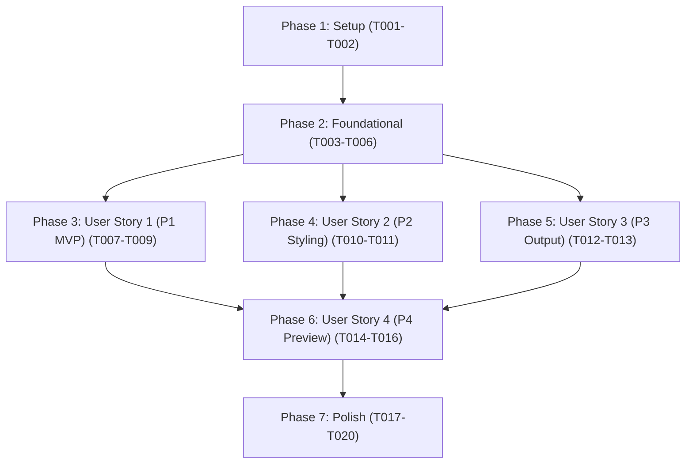

# Tasks: Plugin Settings Tab for Label Configuration

**Branch**: `004-settings-tab` | **Date**: 2026-10-05 | **Spec**: [spec.md](./spec.md) | **Plan**: [plan.md](./plan.md)

---

## Phase 1: Setup (Shared Infrastructure)

**Purpose**: Test harness initialization and mock environment for Obsidian Community Plugin APIs.

- [x] T001 Verify project structure and create target directories (src/settings/, src/ui/, tests/mocks/)
- [x] T002 [P] Implement mock Obsidian API test harness (App, Plugin, PluginSettingTab, Setting, Modal, Notice) in tests/mocks/obsidian.ts

---

## Phase 2: Foundational (Blocking Prerequisites)

**Purpose**: Core settings schema, defaults, validation rules, and mapping helpers required across all user stories.

**⚠️ CRITICAL**: Must complete before user story UI implementation can proceed.

- [x] T003 Define ObsidianLabelSettings interface, preset options, and DEFAULT_SETTINGS in src/settings/types.ts
- [x] T004 Implement validatePluginSettings validation rules in src/settings/validator.ts
- [x] T005 [P] Implement settingsToLabelConfig and settingsToPDFExportOptions mappers in src/settings/mappers.ts
- [x] T006 [P] Create unit tests for settings schema, defaults, validation, and mappers in tests/unit/settings.test.ts

**Checkpoint**: Core settings foundation verified; user story implementation can begin.

---

## Phase 3: User Story 1 - Interactive Label Dimensions & Preset Selection (Priority: P1) 🎯 MVP

**Goal**: Select from standard hardware presets (Dymo, Brother, Avery, Phomemo, Square) or enter custom width and height (mm) with dynamic visibility, validation, and persistence across sessions.

**Independent Test**: Open Obsidian Settings, choose a preset or "Custom Size", verify custom fields dynamically show/hide, verify non-positive inputs are flagged, and verify settings persist via loadData/saveData.

### Tests for User Story 1

- [x] T007 [P] [US1] Create unit tests for preset selection, dynamic custom dimensions visibility, and validation in tests/unit/settings-tab.test.ts

### Implementation for User Story 1

- [x] T008 [US1] Implement ObsidianLabelPlugin settings lifecycle (loadSettings, saveSettings) and register setting tab in src/main.ts
- [x] T009 [US1] Implement ObsidianLabelSettingTab with label size dropdown and dynamic custom width/height inputs in src/ui/settings-tab.ts

**Checkpoint**: User Story 1 MVP fully functional and testable independently.

---

## Phase 4: User Story 2 - Layout, Typography, & Visual Styling Customization (Priority: P2)

**Goal**: Configure QR placement (left, right, top, bottom), QR size slider (10% to 50%), font family dropdown, font size, colors (font, background, border), and border width.

**Independent Test**: Modify QR code placement and size slider, select custom font family, adjust colors and borders in the settings tab, and verify settings are validated and persisted.

### Tests for User Story 2

- [x] T010 [P] [US2] Create unit tests for QR layout, typography, and color styling controls in tests/unit/settings-tab.test.ts

### Implementation for User Story 2

- [x] T011 [US2] Implement QR code layout controls and visual style settings (fonts, colors, borders) in src/ui/settings-tab.ts

**Checkpoint**: User Stories 1 and 2 functional and independently verified.

---

## Phase 5: User Story 3 - PDF Storage Destination & Print Helper Preferences (Priority: P3)

**Goal**: Configure default output storage location (same-as-note, dedicated-folder, custom), custom folder path, date timestamp toggle, and optional printer preferences.

**Independent Test**: Configure output folder mode and timestamp toggle, verify settings map into PDFExportOptions, and verify printer preferences persist.

### Tests for User Story 3

- [x] T012 [P] [US3] Create unit tests for output destination routing, timestamp toggle, and print helper preferences in tests/unit/settings-tab.test.ts

### Implementation for User Story 3

- [x] T013 [US3] Implement output folder controls, custom path field, timestamp toggle, and print helper preferences in src/ui/settings-tab.ts

**Checkpoint**: User Stories 1, 2, and 3 functional and independently verified.

---

## Phase 6: User Story 4 - Live Label Sample Preview from Settings (Priority: P4)

**Goal**: "Preview Label" button in settings tab generates and presents an interactive PreviewModal rendering a live sample label with active note data or realistic fallback.

**Independent Test**: Click "Preview Label" with an active note open and with no note open; verify PreviewModal displays rendered label image and close button dismisses cleanly.

### Tests for User Story 4

- [x] T014 [P] [US4] Create unit tests for resolvePreviewContent active/sample fallback and PreviewModal lifecycle in tests/unit/preview-modal.test.ts

### Implementation for User Story 4

- [x] T015 [US4] Implement resolvePreviewContent and PreviewModal dialog in src/ui/preview-modal.ts
- [x] T016 [US4] Add Preview Label setting button and modal invocation handler in src/ui/settings-tab.ts and src/main.ts

**Checkpoint**: All 4 user stories functional, meeting all settings and preview requirements.

---

## Phase 7: Polish & Cross-Cutting Concerns

**Purpose**: System integration, exports, documentation, and end-to-end verification.

- [x] T017 [P] Re-export settings models, mappers, and UI components in src/index.ts
- [x] T018 Create end-to-end integration tests for plugin lifecycle and quickstart scenarios in tests/integration/settings-integration.test.ts
- [x] T019 [P] Run linter and formatting checks across all source and test files with npm run lint and npm run format
- [x] T020 Verify zero TypeScript compilation errors with npx tsc --noEmit and execute full test suite with npm test

---

## Dependencies & Execution Order

### Phase Dependencies

- **Phase 1 (Setup)**: Can start immediately.
- **Phase 2 (Foundational)**: Depends on Phase 1; blocks all user stories.
- **Phase 3 (User Story 1 - P1 MVP)**: Depends on Phase 2; deliverable on its own.
- **Phase 4 (User Story 2 - P2 Styling)**: Depends on Phase 2; adds styling controls.
- **Phase 5 (User Story 3 - P3 Output)**: Depends on Phase 2; adds output routing.
- **Phase 6 (User Story 4 - P4 Preview)**: Depends on Phase 3 and core generator; adds modal dialog.
- **Phase 7 (Polish)**: Depends on all user stories being completed.

### Parallel Opportunities

- **Setup Phase**: T002 can run in parallel with T001.
- **Foundational Phase**: T005 and T006 can run in parallel with T004.
- **User Story Test Authoring**: T007, T010, T012, and T014 tests can be authored in parallel.
- **Polish Phase**: T017 and T019 can run in parallel.

---

## Implementation Strategy

### MVP First (User Story 1 Only)

1. Complete **Phase 1: Setup** (T001, T002).
2. Complete **Phase 2: Foundational** (T003, T004, T005, T006).
3. Complete **Phase 3: User Story 1** (T007, T008, T009).
4. **Validate MVP**: Run `npx jest tests/unit/settings-tab.test.ts -t "Label Size & Custom Dimensions"` to verify dimensions configuration and persistence work end-to-end.

### Incremental Delivery

1. Foundation ready (T001–T006).
2. User Story 1 delivered (T007–T009) → Core MVP presets & custom dimension controls.
3. User Story 2 delivered (T010–T011) → QR layout and typography/color controls.
4. User Story 3 delivered (T012–T013) → Vault output destination & print helper preferences.
5. User Story 4 delivered (T014–T016) → Live sample preview modal with active/sample note fallback.
6. Polish & Verification (T017–T020) → Re-exports, integration tests, linting, and clean build.
