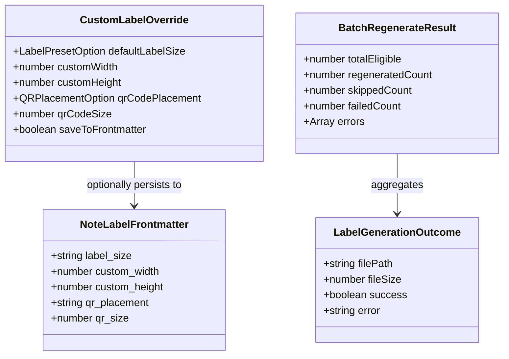

# Data Model: Command Palette Label Actions & Batch Generation

**Feature**: `specs/005-command-palette-actions`  
**Date**: 2026-10-06  
**Status**: Completed

## 1. Domain Entities & Value Objects

---

## 2. Entity Specifications

### 2.1 `CustomLabelOverride`
Temporary or per-note configuration overrides chosen in `CustomLabelModal`.

| Field | Type | Required | Description |
|---|---|---|---|
| `defaultLabelSize` | `LabelPresetOption` | No | Preset identifier or `'custom'` |
| `customWidth` | `number` | No | Width in mm if custom |
| `customHeight` | `number` | No | Height in mm if custom |
| `qrCodePlacement` | `QRPlacementOption` | No | Spatial location of QR code |
| `qrCodeSize` | `number` | No | QR code relative size percentage |
| `saveToFrontmatter` | `boolean` | No | Flag indicating whether to write overrides into note YAML |

### 2.2 `NoteLabelFrontmatter`
Optional YAML metadata stored directly at the top of a Markdown note.

| Property Name | YAML Type | Description |
|---|---|---|
| `label_size` | `string` | Preset ID (e.g. `'brother-62mm'`) or `'custom'` |
| `custom_width` | `number` | Millimeter width for custom stock |
| `custom_height` | `number` | Millimeter height for custom stock |
| `qr_placement` | `string` | Placement (`'left'`, `'right'`, `'top'`, `'bottom'`) |
| `qr_size` | `number` | Percentage (`10` to `50`) |

### 2.3 `BatchRegenerateResult`
Summary outcome returned by vault batch regeneration.

| Field | Type | Description |
|---|---|---|
| `totalEligible` | `number` | Total notes identified with existing generated label PDFs |
| `regeneratedCount` | `number` | Count of successfully regenerated labels |
| `skippedCount` | `number` | Count of notes skipped (e.g. excluded folders) |
| `failedCount` | `number` | Count of notes that encountered generation/write errors |
| `errors` | `Array<{ path: string; message: string }>` | Details of any encountered errors |
