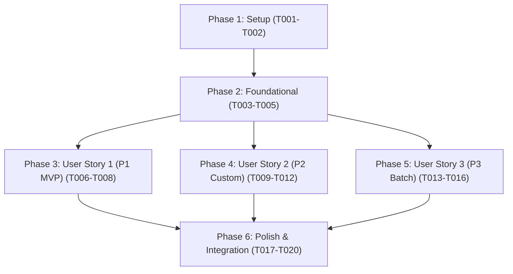

# Tasks: Command Palette Label Actions & Batch Generation

**Branch**: `005-command-palette-actions` | **Date**: 2026-10-06 | **Spec**: [spec.md](./spec.md) | **Plan**: [plan.md](./plan.md)

---

## Phase 1: Setup (Shared Infrastructure)

**Purpose**: Test harness updates and command module scaffolding.

- [x] T001 Verify project structure and create target directories (src/commands/)
- [x] T002 [P] Extend mock Obsidian API test harness in tests/mocks/obsidian.ts with command registration, TFile mock, and fileManager.processFrontMatter support

---

## Phase 2: Foundational (Blocking Prerequisites)

**Purpose**: Core settings resolution hierarchy and note label generation orchestrator required across all commands.

**⚠️ CRITICAL**: Must complete before user story commands can be implemented.

- [x] T003 Implement resolveEffectiveSettingsForNote (hierarchy: overrides > note frontmatter > global settings) in src/commands/orchestrator.ts
- [x] T004 [P] Implement generateLabelForNote generation workflow and success/error notice handling in src/commands/orchestrator.ts
- [x] T005 [P] Create unit tests for settings resolution hierarchy and generateLabelForNote in tests/unit/orchestrator.test.ts

**Checkpoint**: Core note generation and frontmatter resolution ready; user story implementation can begin.

---

## Phase 3: User Story 1 - Instant Label Generation for Active Note (Priority: P1) 🎯 MVP

**Goal**: Fast keyboard-driven command ("Generate Label for Current Note") with conditional workspace check and completion notice.

**Independent Test**: Open any markdown note, run "Generate Label for Current Note" from the Command Palette, verify PDF is generated in the configured vault directory with an informative completion notification, and verify command is disabled when no file is active.

### Tests for User Story 1

- [x] T006 [P] [US1] Create unit tests for generate-label-current-note command callback and checkCallback logic in tests/unit/commands.test.ts

### Implementation for User Story 1

- [x] T007 [US1] Implement registerLabelCommands for generate-label-current-note in src/commands/register.ts
- [x] T008 [US1] Wire command registration and active file invocation lifecycle in src/main.ts

**Checkpoint**: User Story 1 MVP fully functional and independently testable.

---

## Phase 4: User Story 2 - Per-Note Custom Label Generation Dialog (Priority: P2)

**Goal**: Interactive `CustomLabelModal` allowing per-note overrides of label size, custom dimensions, and QR placement, with optional "Save as note default" toggle writing to note YAML frontmatter.

**Independent Test**: Trigger "Generate Label with Custom Settings...", select overrides in modal, verify generated PDF reflects overrides without changing global settings, and verify checking "Save as note default" writes to note frontmatter.

### Tests for User Story 2

- [x] T009 [P] [US2] Create unit tests for CustomLabelModal rendering, overrides handling, and frontmatter saving in tests/unit/custom-label-modal.test.ts

### Implementation for User Story 2

- [x] T010 [US2] Implement CustomLabelModal dialog with size overrides, QR placement, and frontmatter save toggle in src/ui/custom-label-modal.ts
- [x] T011 [US2] Register generate-label-custom command with checkCallback in src/commands/register.ts
- [x] T012 [US2] Wire generate-label-custom modal launch handler in src/main.ts

**Checkpoint**: User Stories 1 and 2 functional and independently testable.

---

## Phase 5: User Story 3 - Vault-Wide Batch Label Regeneration (Priority: P3)

**Goal**: Batch command to regenerate labels across the vault with confirmation modal, filtering to notes with existing label PDFs, skipping `.trash` and hidden folders, with non-blocking execution and progress/summary notices.

**Independent Test**: Run "Regenerate All Labels in Vault", verify `BatchConfirmModal` prompts with note count, verify only notes with existing label PDFs are regenerated, and verify completion notice displays total count.

### Tests for User Story 3

- [x] T013 [P] [US3] Create unit tests for BatchConfirmModal and batch existing label discovery in tests/unit/batch-regeneration.test.ts

### Implementation for User Story 3

- [x] T014 [US3] Implement BatchConfirmModal with note count and confirmation buttons in src/ui/batch-confirm-modal.ts
- [x] T015 [US3] Implement regenerateAllLabels batch discovery and asynchronous execution in src/commands/batch-processor.ts
- [x] T016 [US3] Register regenerate-all-labels command and wire batch confirmation workflow in src/commands/register.ts and src/main.ts

**Checkpoint**: All 3 user stories functional and meeting all specification requirements.

---

## Phase 6: Polish & Cross-Cutting Concerns

**Purpose**: System integration, module exports, linting, and end-to-end verification.

- [x] T017 [P] Re-export command services, modals, and orchestrator types in src/index.ts
- [x] T018 Create end-to-end integration tests for command palette flows and quickstart scenarios in tests/integration/commands-integration.test.ts
- [x] T019 [P] Run linter and formatting checks across all source and test files with npm run lint and npm run format
- [x] T020 Verify zero TypeScript compilation errors with npx tsc --noEmit and execute full test suite with npm test

---

## Dependencies & Execution Order

### Phase Dependencies

- **Phase 1 (Setup)**: Can start immediately.
- **Phase 2 (Foundational)**: Depends on Phase 1; blocks all user stories.
- **Phase 3 (User Story 1 - P1 MVP)**: Depends on Phase 2; deliverable independently.
- **Phase 4 (User Story 2 - P2 Custom)**: Depends on Phase 2; adds custom modal.
- **Phase 5 (User Story 3 - P3 Batch)**: Depends on Phase 2; adds batch processor and confirmation modal.
- **Phase 6 (Polish)**: Depends on all user stories being completed.

### Parallel Opportunities

- **Setup Phase**: T002 can run in parallel with T001.
- **Foundational Phase**: T004 and T005 can run in parallel with T003.
- **User Story Test Authoring**: T006, T009, and T013 tests can be authored in parallel.
- **Polish Phase**: T017 and T019 can run in parallel.

---

## Implementation Strategy

### MVP First (User Story 1 Only)

1. Complete **Phase 1: Setup** (T001, T002).
2. Complete **Phase 2: Foundational** (T003, T004, T005).
3. Complete **Phase 3: User Story 1** (T006, T007, T008).
4. **Validate MVP**: Run `npx jest tests/unit/commands.test.ts` to verify "Generate Label for Current Note" works end-to-end.

### Incremental Delivery

1. Foundation ready (T001–T005).
2. User Story 1 delivered (T006–T008) → Core MVP command palette generation.
3. User Story 2 delivered (T009–T012) → Per-note custom overrides modal and frontmatter persistence.
4. User Story 3 delivered (T013–T016) → Vault batch regeneration with confirmation.
5. Polish & Verification (T017–T020) → Re-exports, integration tests, linting, and clean build.
