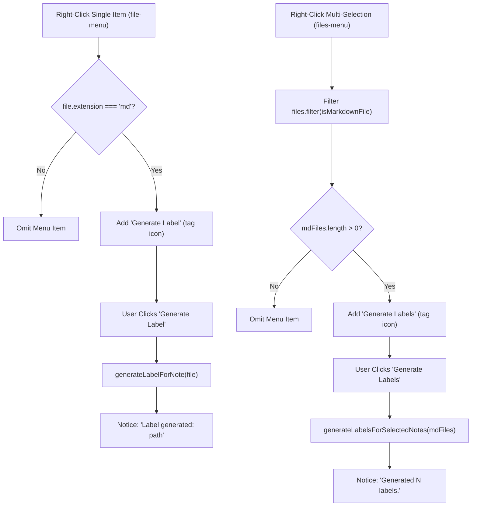

# Data Model: File Explorer Context Menu Label Action

**Feature**: `specs/006-file-context-menu`  
**Date**: 2026-10-06  
**Status**: Completed  

---

## Entities & Type Definitions

### 1. `FileContextMenuContext`

Encapsulates the runtime context provided when an individual file is targeted via Obsidian's `file-menu` event.

| Field | Type | Description |
|---|---|---|
| `file` | `TFile` | The targeted Markdown note file. |
| `app` | `App` | Active Obsidian application instance. |
| `settings` | `ObsidianLabelSettings` | Active plugin configuration. |

**Validation Rules**:
- `file` MUST be an instance of `TFile`.
- `file.extension` MUST equal `'md'`.
- Folders (`TFolder`) and non-markdown files MUST be rejected by the type guard.

---

### 2. `MultiFileContextMenuContext`

Encapsulates the runtime context provided when multiple items are selected and targeted via Obsidian's `files-menu` event.

| Field | Type | Description |
|---|---|---|
| `files` | `TFile[]` | Array of targeted Markdown note files (filtered from raw selection). |
| `app` | `App` | Active Obsidian application instance. |
| `settings` | `ObsidianLabelSettings` | Active plugin configuration. |

**Validation Rules**:
- `files` MUST contain only instances of `TFile` with `extension === 'md'`.
- If `files.length === 0`, the menu action is not registered on the menu.

---

### 3. `MultiFileGenerationResult`

Represents the aggregated execution results of a multi-file context menu generation pass.

| Field | Type | Description |
|---|---|---|
| `totalSelected` | `number` | Total number of raw files/folders in the user's initial selection. |
| `markdownCount` | `number` | Count of eligible Markdown notes among the selection. |
| `generatedCount` | `number` | Count of successfully rendered and saved label PDFs. |
| `failedCount` | `number` | Count of notes that failed rendering or file system write. |
| `errors` | `Array<{ path: string; message: string }>` | Descriptive error messages for failed notes. |

---

## State & Data Flow

