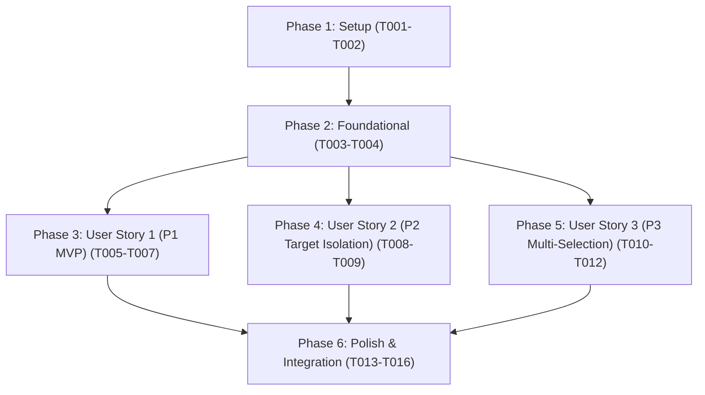

# Tasks: File Explorer Context Menu Label Action

**Branch**: `006-file-context-menu` | **Date**: 2026-10-06 | **Spec**: [spec.md](./spec.md) | **Plan**: [plan.md](./plan.md)

---

## Phase 1: Setup (Shared Infrastructure)

**Purpose**: Test harness updates and context menu scaffolding.

- [x] T001 Extend mock Obsidian API test harness in tests/mocks/obsidian.ts with Menu, MenuItem, and workspace file-menu / files-menu event triggers
- [x] T002 [P] Create context menu module scaffolding and contract imports in src/commands/context-menu.ts

---

## Phase 2: Foundational (Blocking Prerequisites)

**Purpose**: Shared file type guard validation and plugin lifecycle event wiring.

**⚠️ CRITICAL**: Must complete before user story context menu listeners can be tested and registered.

- [x] T003 Implement markdown file filtering and error handling wrapper in src/commands/context-menu.ts
- [x] T004 [P] Wire registerFileMenuEvents lifecycle registration into src/main.ts

**Checkpoint**: Core test harness and event scaffolding ready; user story implementation can begin.

---

## Phase 3: User Story 1 - Instant Label Generation via File Context Menu (Priority: P1) 🎯 MVP

**Goal**: Right-clicking an individual Markdown note in the file explorer adds a "Generate Label" menu item with a tag icon that generates and exports a label PDF using active settings.

**Independent Test**: Right-click any markdown file in the file explorer, verify "Generate Label" appears with a tag icon, click the item, and verify that a PDF label is generated in the configured vault directory with an informative completion notification.

### Tests for User Story 1

- [x] T005 [P] [US1] Create unit tests for single-note file-menu event handling, menu title/icon verification, and non-markdown/folder exclusion in tests/unit/context-menu.test.ts

### Implementation for User Story 1

- [x] T006 [US1] Implement file-menu event listener in src/commands/context-menu.ts registering Generate Label item with tag icon and invoking generateLabelForNote
- [x] T007 [US1] Integrate file-menu event registration into registerFileMenuEvents in src/commands/context-menu.ts

**Checkpoint**: User Story 1 MVP fully functional and independently testable.

---

## Phase 4: User Story 2 - Context Menu Availability Across Workspace File Navigation Views (Priority: P2)

**Goal**: Context menu action consistently targets the right-clicked file across all navigation views without being affected by the active editor note.

**Independent Test**: Focus Note A in editor, right-click Note B in file explorer, click "Generate Label", and verify label is generated strictly for Note B.

### Tests for User Story 2

- [x] T008 [P] [US2] Create unit tests verifying target note independence when a different file is active in the workspace editor in tests/unit/context-menu.test.ts

### Implementation for User Story 2

- [x] T009 [US2] Verify target note isolation in src/commands/context-menu.ts ensuring editor active file is never substituted for right-clicked target

**Checkpoint**: User Stories 1 and 2 functional and independently testable.

---

## Phase 5: User Story 3 - Multi-File Context Menu Batch Generation (Priority: P3)

**Goal**: Multi-selecting files in the file explorer and right-clicking adds "Generate Labels" when at least one Markdown note is selected, batch-generating labels for all selected notes and reporting a summary notice.

**Independent Test**: Multi-select 3 markdown notes in file explorer, right-click, select "Generate Labels", and verify that all 3 notes have PDF labels generated with a summary completion notice.

### Tests for User Story 3

- [x] T010 [P] [US3] Create unit tests for files-menu multi-selection, Generate Labels menu title/icon, mixed file filtering, and batch summary notices in tests/unit/context-menu.test.ts

### Implementation for User Story 3

- [x] T011 [US3] Implement generateLabelsForSelectedNotes batch iteration helper with event loop yielding in src/commands/context-menu.ts
- [x] T012 [US3] Implement files-menu event listener in src/commands/context-menu.ts registering Generate Labels item for multi-selections

**Checkpoint**: All 3 user stories functional and meeting all specification requirements.

---

## Phase 6: Polish & Cross-Cutting Concerns

**Purpose**: System integration, module exports, linting, and end-to-end verification.

- [x] T013 [P] Re-export context menu services and types in src/index.ts
- [x] T014 Create end-to-end integration tests for file explorer context menu flows and quickstart scenarios in tests/integration/context-menu-integration.test.ts
- [x] T015 [P] Run linter and formatting checks across all source and test files with npm run lint and npm run format
- [x] T016 Verify zero TypeScript compilation errors with npx tsc --noEmit and execute full test suite with npm test

---

## Dependencies & Execution Order

### Phase Dependencies

- **Phase 1 (Setup)**: Can start immediately.
- **Phase 2 (Foundational)**: Depends on Phase 1; blocks all user stories.
- **Phase 3 (User Story 1 - P1 MVP)**: Depends on Phase 2; deliverable independently.
- **Phase 4 (User Story 2 - P2 Target Isolation)**: Depends on Phase 2; ensures navigation surface independence.
- **Phase 5 (User Story 3 - P3 Multi-Selection)**: Depends on Phase 2; adds `files-menu` batch execution.
- **Phase 6 (Polish)**: Depends on all user stories being completed.

### Parallel Opportunities

- **Setup Phase**: T001 and T002 can run in parallel.
- **Foundational Phase**: T004 can run in parallel with T003.
- **User Story Test Authoring**: T005, T008, and T010 tests can be authored in parallel.
- **Polish Phase**: T013 and T015 can run in parallel.

---

## Implementation Strategy

### MVP First (User Story 1 Only)

1. Complete **Phase 1: Setup** (T001, T002).
2. Complete **Phase 2: Foundational** (T003, T004).
3. Complete **Phase 3: User Story 1** (T005, T006, T007).
4. **Validate MVP**: Run `npx jest tests/unit/context-menu.test.ts -t "single-file menu"` to verify right-clicking a note produces a label.

### Incremental Delivery

1. Foundation ready (T001–T004).
2. User Story 1 delivered (T005–T007) → Single-file context menu MVP.
3. User Story 2 delivered (T008–T009) → Target note isolation across workspace surfaces.
4. User Story 3 delivered (T010–T012) → Multi-file selection batch generation.
5. Polish & Verification (T013–T016) → Public exports, integration tests, linting, and full test suite passing.
