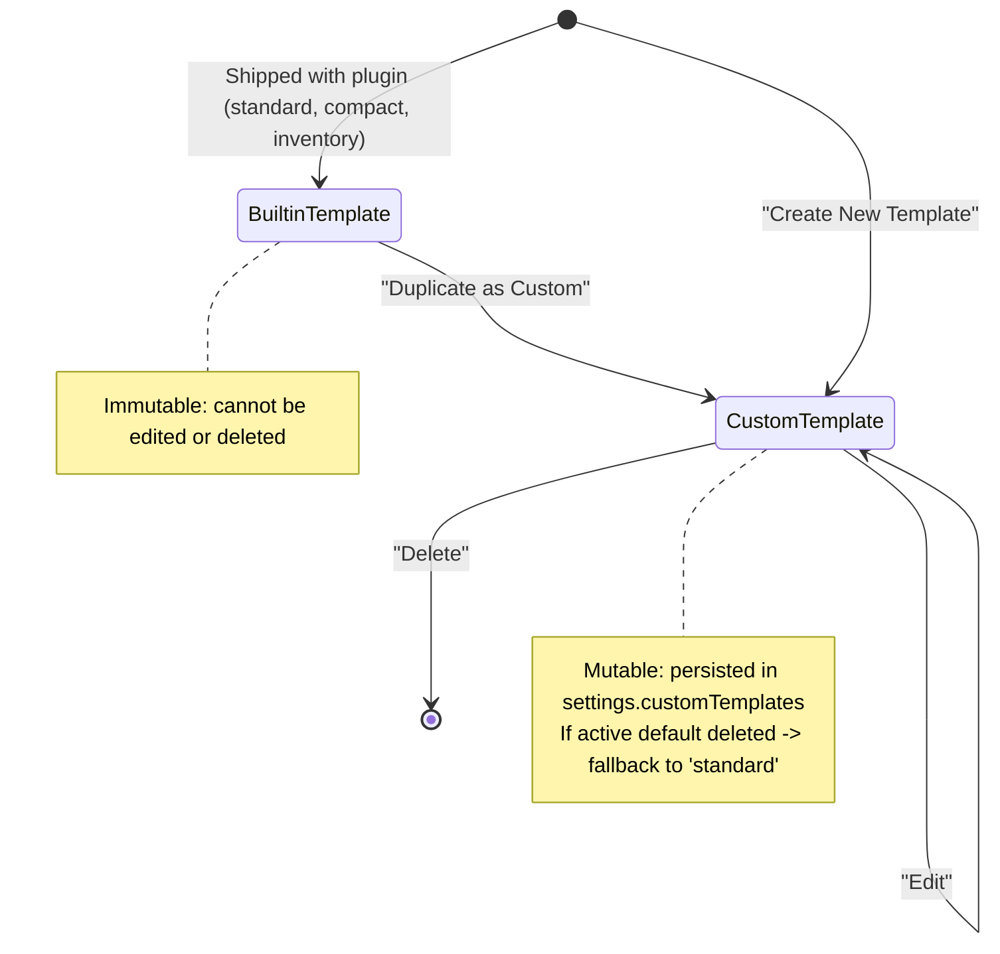

# Data Model: Label Templates & Custom Template System

**Feature Branch**: `007-label-templates`  
**Date**: 2026-10-07  
**Status**: Draft  

---

## 1. Entities & Interfaces

### 1.1 `LabelTemplate`
The top-level composite entity encapsulating physical size, layout, styling, and content extraction rules.

```typescript
export interface LabelTemplate {
  /** Unique identifier (lowercase alphanumeric + hyphens; e.g., 'standard', 'custom-shelf-tag') */
  id: string;

  /** Human-readable display name */
  name: string;

  /** Explanatory description of intended use */
  description: string;

  /** Physical dimensions */
  labelSize: TemplateSize;

  /** Spatial arrangement parameters */
  layout: TemplateLayout;

  /** Visual and typographical styling */
  style: TemplateStyle;

  /** Field display toggles and frontmatter extraction rules */
  contentRules: ContentRules;

  /** Whether this template is a built-in immutable system preset */
  isBuiltin?: boolean;
}
```

### 1.2 `TemplateSize`
Physical dimensions in millimeters and print resolution.

```typescript
export interface TemplateSize {
  /** Width in millimeters (min: 15, max: 300) */
  width: number;

  /** Height in millimeters (min: 15, max: 300) */
  height: number;

  /** Print resolution in DPI (default: 300) */
  dpi: number;
}
```

### 1.3 `TemplateLayout`
Spatial positioning and alignment parameters for the QR code and text content.

```typescript
export type QRPlacement = 'left' | 'right' | 'top' | 'bottom' | 'center' | 'none';
export type TextAlignment = 'left' | 'center' | 'right';

export interface Margins {
  top: number;
  right: number;
  bottom: number;
  left: number;
}

export interface TemplateLayout {
  /** Relative placement of QR code on label */
  qrCodePlacement: QRPlacement;

  /** Size of QR code in millimeters or percentage (10 to 100) */
  qrCodeSize: number;

  /** Inset padding from label edges in millimeters */
  margins: Margins;

  /** Text content horizontal alignment */
  textAlignment: TextAlignment;
}
```

### 1.4 `TemplateStyle`
Visual presentation parameters for colors, typography, and borders.

```typescript
export interface TemplateStyle {
  /** Font family (e.g., 'Arial', 'Courier New', 'Times New Roman', 'sans-serif') */
  fontFamily: string;

  /** Font size in typographical points (min: 4, max: 72) */
  fontSize: number;

  /** Hex color for text content (e.g., '#000000') */
  fontColor: string;

  /** Hex color for label background (e.g., '#FFFFFF') */
  backgroundColor: string;

  /** Border stroke width in points/pixels (0 for borderless) */
  borderWidth: number;

  /** Hex color for border stroke (e.g., '#CCCCCC') */
  borderColor: string;
}
```

### 1.5 `ContentRules`
Rules governing what metadata fields are extracted and rendered on the label.

```typescript
export interface ContentRules {
  /** Render note title (basename) */
  showTitle: boolean;

  /** Render note relative folder path */
  showPath: boolean;

  /** Render note creation timestamp */
  showDateCreated: boolean;

  /** Render note last modification timestamp */
  showDateModified: boolean;

  /** Array of frontmatter YAML keys to extract and render as key-value pairs */
  customFields: string[];

  /** Maximum character length for note title before truncation with ellipsis */
  titleMaxLength: number;
}
```

### 1.6 `ContentLine`
Intermediate structured representation of a rendered text line on the label canvas.

```typescript
export type ContentLineType = 'title' | 'path' | 'date_created' | 'date_modified' | 'custom_field';

export interface ContentLine {
  /** Line categorization */
  type: ContentLineType;

  /** Optional label prefix (e.g. 'Category', 'Location') */
  label?: string;

  /** Formatted text string */
  text: string;
}
```

---

## 2. Setting Schema Extensions

Extensions to `ObsidianLabelSettings` in `src/settings/types.ts`:

```typescript
export interface ObsidianLabelSettings {
  // Existing settings (vaultName, defaultLabelSize, etc.)
  ...

  /** Active default template identifier (default: 'standard') */
  defaultTemplate: string;

  /** User-defined custom templates */
  customTemplates: LabelTemplate[];
}

export const DEFAULT_SETTINGS: ObsidianLabelSettings = {
  ...
  defaultTemplate: 'standard',
  customTemplates: [],
};
```

---

## 3. Validation Rules & Constraints

| Field / Rule | Constraint | Error Message |
|:---|:---|:---|
| `template.id` | Alphanumeric lowercase and hyphens (`^[a-z0-9-]+$`), non-empty | "Template ID must contain only lowercase letters, numbers, and hyphens." |
| `template.name` | 1–50 characters, trimmed, non-empty | "Template name is required (max 50 characters)." |
| `template.id uniqueness` | Must not match reserved built-in IDs (`standard`, `compact`, `inventory`) or existing custom template IDs | "Template ID or name already exists." |
| `labelSize.width` | 15 mm <= width <= 300 mm | "Label width must be between 15 mm and 300 mm." |
| `labelSize.height` | 15 mm <= height <= 300 mm | "Label height must be between 15 mm and 300 mm." |
| `layout.margins` | Margins >= 0, `margin.left + margin.right < width`, `margin.top + margin.bottom < height` | "Margins cannot exceed label dimensions." |
| `layout.qrCodeSize` | 10 <= qrCodeSize <= 100 | "QR size must be between 10 and 100." |
| `style.fontSize` | 4 <= fontSize <= 72 | "Font size must be between 4 and 72." |
| `style.borderWidth` | borderWidth >= 0 | "Border width must be non-negative." |
| `contentRules.titleMaxLength` | titleMaxLength >= 1 | "Title max length must be at least 1." |

---

## 4. Lifecycle & State Transitions


