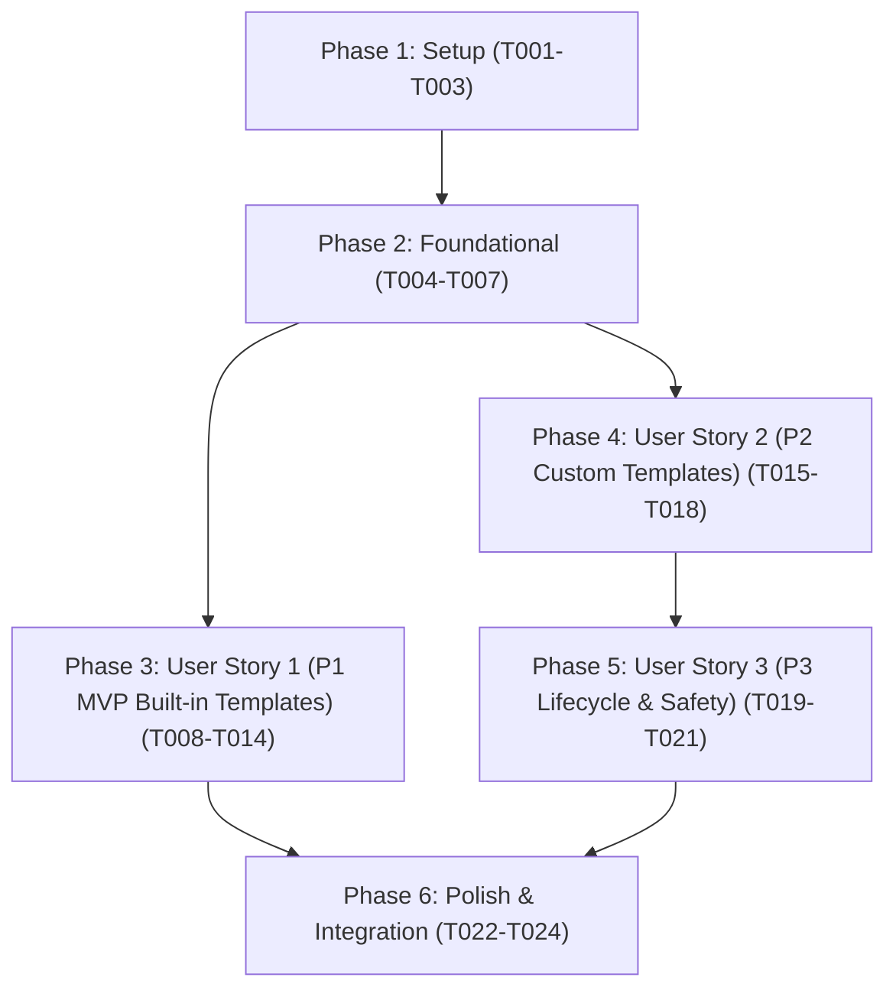

# Tasks: Label Templates & Custom Template System

**Branch**: `007-label-templates` | **Date**: 2026-10-07 | **Spec**: [spec.md](./spec.md) | **Plan**: [plan.md](./plan.md)

---

## Phase 1: Setup (Shared Infrastructure)

**Purpose**: Project schema definitions, built-in presets, and settings storage extensions.

- [x] T001 Create template interfaces and type definitions in src/templates/types.ts
- [x] T002 [P] Implement immutable built-in templates constant (Standard, Compact, Inventory) in src/templates/builtin.ts
- [x] T003 Extend ObsidianLabelSettings and DEFAULT_SETTINGS with defaultTemplate and customTemplates in src/settings/types.ts

---

## Phase 2: Foundational (Blocking Prerequisites)

**Purpose**: Core template registry, validation, and content extraction pipeline required by all user stories.

**⚠️ CRITICAL**: Must complete before user story implementation and UI wiring can begin.

- [x] T004 Implement template registry, validation, and CRUD helpers in src/templates/registry.ts
- [x] T005 [P] Implement metadata content extraction, title truncation, and frontmatter array serialization in src/templates/extractor.ts
- [x] T006 Author unit tests for template registry, validation, and fallback resolution in tests/unit/template-registry.test.ts
- [x] T007 [P] Author unit tests for content extraction, array serialization, and title truncation in tests/unit/template-extractor.test.ts

**Checkpoint**: Core template registry and extraction engine functional and verified by unit tests.

---

## Phase 3: User Story 1 - Built-in Templates & Template-Driven Label Generation (Priority: P1) 🎯 MVP

**Goal**: Users can select built-in templates ("Standard", "Compact", "Inventory") in settings, generating labels that match specified dimensions, layout geometry, typography, and content extraction rules.

**Independent Test**: Generate labels with "Standard", "Compact", and "Inventory" templates for notes with metadata, verifying PDF dimensions, QR placement, styling, title truncation, and extracted frontmatter fields.

### Tests for User Story 1

- [x] T008 [P] [US1] Author unit tests for template-driven canvas rendering and vertical text overflow omission in tests/unit/template-renderer.test.ts
- [x] T009 [P] [US1] Author integration tests for US1 quickstart scenarios (Standard, Compact, Inventory, frontmatter override) in tests/integration/template-integration.test.ts

### Implementation for User Story 1

- [x] T010 [US1] Update canvas renderer and layout in src/core/canvas-renderer.ts and src/core/layout.ts to support multiline template content lines and vertical overflow omission
- [x] T011 [US1] Update label generator in src/core/label-generator.ts to accept LabelTemplate options
- [x] T012 [US1] Update orchestrator in src/commands/orchestrator.ts to resolve effective templates (modal > frontmatter > vault default > 'standard') and evaluate content rules
- [x] T013 [US1] Add Default Template dropdown setting to src/ui/settings-tab.ts displaying built-in templates
- [x] T014 [US1] Update CustomLabelModal in src/ui/custom-label-modal.ts to include a Template dropdown selector for ad-hoc generation

**Checkpoint**: User Story 1 MVP fully functional and independently testable across all 3 built-in templates.

---

## Phase 4: User Story 2 - Custom Template Creation & Management (Priority: P2)

**Goal**: Power users can create, configure, and edit custom templates through an interactive Template Manager and Editor modal.

**Independent Test**: Open Template Manager from settings, click "Create New Template", define custom dimensions, styling, and content rules, save it, and verify that the new custom template appears in the dropdown and generates valid labels.

### Tests for User Story 2

- [x] T015 [P] [US2] Author unit tests for TemplateManagerModal and TemplateEditorModal workflows in tests/unit/template-modals.test.ts

### Implementation for User Story 2

- [x] T016 [US2] Implement TemplateEditorModal interactive form in src/ui/template-editor-modal.ts with validation for dimensions, margins, and content rules
- [x] T017 [US2] Implement TemplateManagerModal in src/ui/template-manager-modal.ts listing custom templates with Edit actions and Create New Template CTA
- [x] T018 [US2] Add Manage Templates button setting to src/ui/settings-tab.ts and update template selector dropdown to display custom templates marked as (custom)

**Checkpoint**: User Stories 1 and 2 functional; custom templates can be created, edited, persisted, and selected.

---

## Phase 5: User Story 3 - Custom Template Lifecycle & Safety (Priority: P3)

**Goal**: Users can duplicate existing templates as custom starting points and safely delete custom templates with automatic fallback to "Standard" if the active template is removed.

**Independent Test**: Duplicate a built-in template as a custom template, delete a custom template that is currently selected as active default, and verify that defaultTemplate safely reverts to "Standard" without throwing errors.

### Tests for User Story 3

- [x] T019 [P] [US3] Author lifecycle and fallback unit tests for duplication and active template deletion in tests/unit/template-modals.test.ts

### Implementation for User Story 3

- [x] T020 [US3] Add Duplicate as Custom action for built-in and custom templates in src/ui/template-manager-modal.ts
- [x] T021 [US3] Implement safe template deletion with confirmation and active default fallback to 'standard' in src/ui/template-manager-modal.ts and src/templates/registry.ts

**Checkpoint**: All 3 user stories complete and protected against deletion corruption or lost settings references.

---

## Phase 6: Polish & Cross-Cutting Concerns

**Purpose**: Public module exports, linter checks, formatting, and end-to-end verification.

- [x] T022 [P] Re-export all template types, built-in presets, and registry services in src/index.ts
- [x] T023 [P] Run linter and formatting checks across all source and test files with npm run lint and npm run format
- [x] T024 Verify zero TypeScript compilation errors with npx tsc --noEmit and execute full test suite with npm test

---

## Dependencies & Execution Order

### Phase Dependencies

- **Phase 1 (Setup)**: Can start immediately.
- **Phase 2 (Foundational)**: Depends on Phase 1; blocks all user stories.
- **Phase 3 (User Story 1 - P1 MVP)**: Depends on Phase 2; deliverable independently as a functional MVP.
- **Phase 4 (User Story 2 - P2 Custom Templates)**: Depends on Phase 2 and integrates with US1 UI settings.
- **Phase 5 (User Story 3 - P3 Lifecycle & Safety)**: Depends on Phase 4 custom template manager.
- **Phase 6 (Polish)**: Depends on all user stories being completed.

### Parallel Opportunities

- **Setup Phase**: T002 can run in parallel with T001 and T003.
- **Foundational Phase**: T005 and T007 can run in parallel with T004 and T006.
- **User Story 1 Tests**: T008 and T009 can be authored in parallel before implementation.
- **User Story 2 Tests**: T015 can be authored in parallel with US1 implementation.
- **Polish Phase**: T022 and T023 can run in parallel.

---

## Implementation Strategy

### MVP First (User Story 1 Only)

1. Complete **Phase 1: Setup** (T001–T003).
2. Complete **Phase 2: Foundational** (T004–T007).
3. Complete **Phase 3: User Story 1** (T008–T014).
4. **Validate MVP**: Run `npx jest tests/integration/template-integration.test.ts` to verify label generation with all 3 built-in templates.

### Incremental Delivery

1. Foundation ready (T001–T007).
2. User Story 1 delivered (T008–T014) → Built-in templates MVP available.
3. User Story 2 delivered (T015–T018) → Custom template creation and editing available.
4. User Story 3 delivered (T019–T021) → Duplication and safe deletion lifecycle available.
5. Polish & Verification (T022–T024) → Public exports, clean lint/format, full test suite passing.
