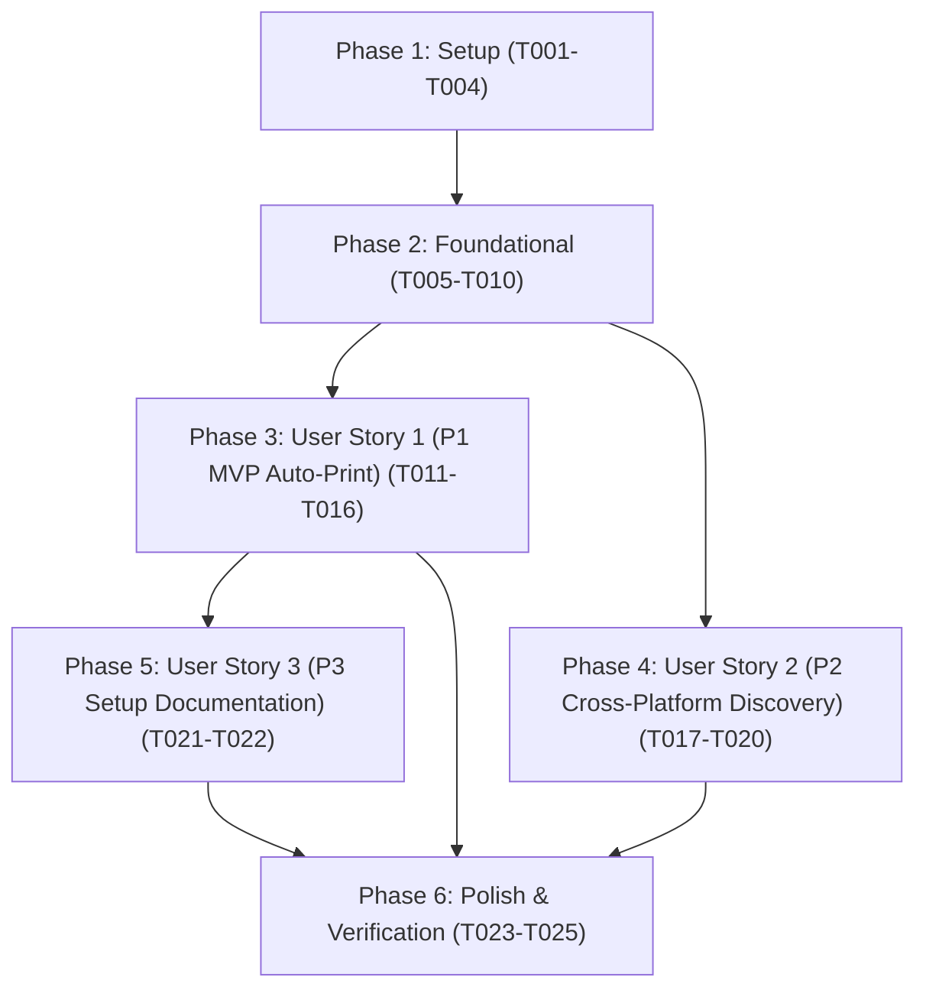

# Tasks: Printer Helper Scripts & Auto-Print

**Branch**: `008-printer-helper-scripts` | **Date**: 2026-10-07 | **Spec**: [spec.md](./spec.md) | **Plan**: [plan.md](./plan.md)

---

## Phase 1: Setup (Shared Infrastructure)

**Purpose**: Data types, settings extensions, and native OS script templates.

- [x] T001 Create printer type definitions (PrintJob, PrintResult, PrintScriptInfo, ScriptType, PrintExecutionOptions) in src/printer/types.ts
- [x] T002 [P] Extend ObsidianLabelSettings and DEFAULT_SETTINGS with printScriptPath in src/settings/types.ts
- [x] T003 [P] Implement executable Bash helper script with CUPS error listing in scripts/print-label.sh
- [x] T004 [P] Implement executable PowerShell helper script with Get-Printer error listing in scripts/print-label.ps1

---

## Phase 2: Foundational (Blocking Prerequisites)

**Purpose**: Core printer service, script detection, and command construction engine required by all user stories.

**⚠️ CRITICAL**: Must complete before user story implementation and UI wiring can begin.

- [x] T005 Implement shell command builder with safe argument quoting in src/printer/command-builder.ts
- [x] T006 [P] Implement multi-tier script detector in src/printer/script-detector.ts
- [x] T007 [P] Implement asynchronous print service with 10-second timeout in src/printer/print-service.ts
- [x] T008 [P] Author unit tests for command builder and argument escaping in tests/unit/command-builder.test.ts
- [x] T009 [P] Author unit tests for script detection and path fallback in tests/unit/script-detector.test.ts
- [x] T010 [P] Author unit tests for process execution, error handling, and timeout in tests/unit/print-service.test.ts

**Checkpoint**: Core printer service engine functional and verified by unit tests.

---

## Phase 3: User Story 1 - Automated Print Dispatch on Label Generation (Priority: P1) 🎯 MVP

**Goal**: Users can automatically dispatch generated PDF labels directly to the physical printer via the helper script without opening manual viewer dialogues.

**Independent Test**: Enable auto-print in settings, specify a printer name, generate a label for an active note, and verify that the print helper script is invoked with the generated PDF path and printer name, showing an Obsidian Notice upon dispatch.

### Tests for User Story 1

- [x] T011 [P] [US1] Author unit tests for orchestrator auto-print dispatch and error handling in tests/unit/orchestrator-print.test.ts
- [x] T012 [P] [US1] Author integration tests for US1 auto-print scenarios (enabled, disabled, missing printer, failure) in tests/integration/auto-print-integration.test.ts

### Implementation for User Story 1

- [x] T013 [US1] Update orchestrator in src/commands/orchestrator.ts to dispatch print jobs following successful PDF export when autoPrint is enabled
- [x] T014 [US1] Update settings tab in src/ui/settings-tab.ts to reveal printScriptPath input when autoPrint is enabled
- [x] T015 [US1] Add Test Print action button to src/ui/settings-tab.ts that prints a sample label to verify printer connectivity
- [x] T016 [US1] Update batch confirmation modal and processor in src/ui/batch-confirm-modal.ts and src/commands/batch-processor.ts to add batch print confirmation checkbox guard

**Checkpoint**: User Story 1 MVP fully functional and independently testable.

---

## Phase 4: User Story 2 - Cross-Platform Helper Scripts & Automatic Script Discovery (Priority: P2)

**Goal**: Native Bash and PowerShell helper scripts validate PDF existence and printer queues, while the plugin auto-detects scripts from plugin installation directory.

**Independent Test**: Execute scripts/print-label.sh and scripts/print-label.ps1 directly from the command line with missing PDF and invalid printer arguments to verify diagnostic messages and exit code 1; verify plugin auto-discovers bundled scripts when printScriptPath is blank.

### Tests for User Story 2

- [x] T017 [P] [US2] Author unit tests for cross-platform script detection across Linux, macOS, and Windows in tests/unit/script-detector.test.ts

### Implementation for User Story 2

- [x] T018 [US2] Ensure POSIX permissions and CUPS printer queue diagnostics in scripts/print-label.sh
- [x] T019 [US2] Configure PowerShell execution policy bypass and printer enumeration diagnostics in scripts/print-label.ps1
- [x] T020 [US2] Implement platform-aware fallback logic in src/printer/script-detector.ts handling process.platform variations

**Checkpoint**: User Stories 1 and 2 functional across Linux, macOS, and Windows environments.

---

## Phase 5: User Story 3 - Printer Setup Documentation & Configuration Guidance (Priority: P3)

**Goal**: Users have comprehensive printer setup documentation explaining how to identify exact printer names on Linux, macOS, and Windows, configure Obsidian settings, and troubleshoot OS permissions or execution policy errors.

**Independent Test**: Review docs/PRINTER_SETUP.md against clean setup scenarios to verify accurate lpstat -p and Get-Printer discovery commands and troubleshooting steps.

### Implementation for User Story 3

- [x] T021 [P] [US3] Create comprehensive printer setup guide in docs/PRINTER_SETUP.md covering printer discovery and OS troubleshooting
- [x] T022 [US3] Add setup guide documentation link in src/ui/settings-tab.ts under printer settings

**Checkpoint**: All 3 user stories complete with user documentation and self-service troubleshooting.

---

## Phase 6: Polish & Cross-Cutting Concerns

**Purpose**: Public module exports, linter checks, formatting, and end-to-end verification.

- [x] T023 [P] Re-export printer module services, command builders, and types in src/index.ts
- [x] T024 [P] Run linter and formatting checks across all source and test files with npm run lint and npm run format
- [x] T025 Verify zero TypeScript compilation errors with npx tsc --noEmit and execute full test suite with npm test

---

## Dependencies & Execution Order

### Phase Dependencies

- **Phase 1 (Setup)**: Can start immediately.
- **Phase 2 (Foundational)**: Depends on Phase 1; blocks all user stories.
- **Phase 3 (User Story 1 - P1 MVP)**: Depends on Phase 2; deliverable independently as a functional MVP.
- **Phase 4 (User Story 2 - P2 Scripts & Discovery)**: Depends on Phase 2 and integrates with US1 script execution.
- **Phase 5 (User Story 3 - P3 Setup Documentation)**: Depends on US1 settings UI.
- **Phase 6 (Polish)**: Depends on all user stories being completed.

### Parallel Opportunities

- **Setup Phase**: T002, T003, T004 can run in parallel with T001.
- **Foundational Phase**: T006, T007 can run in parallel with T005; T008, T009, T010 can run in parallel.
- **User Story 1 Tests**: T011 and T012 can be authored in parallel before implementation.
- **User Story 3**: T021 can be written in parallel with US1 UI wiring.
- **Polish Phase**: T023 and T024 can run in parallel.

---

## Implementation Strategy

### MVP First (User Story 1 Only)

1. Complete **Phase 1: Setup** (T001–T004).
2. Complete **Phase 2: Foundational** (T005–T010).
3. Complete **Phase 3: User Story 1** (T011–T016).
4. **Validate MVP**: Run `npx jest tests/integration/auto-print-integration.test.ts` to verify auto-print dispatch.

### Incremental Delivery

1. Foundation ready (T001–T010).
2. User Story 1 delivered (T011–T016) → Auto-print MVP available.
3. User Story 2 delivered (T017–T020) → Full cross-platform script detection & diagnostics available.
4. User Story 3 delivered (T021–T022) → Printer setup documentation guide available.
5. Polish & Verification (T023–T025) → Public exports, clean lint/format, full test suite passing.
