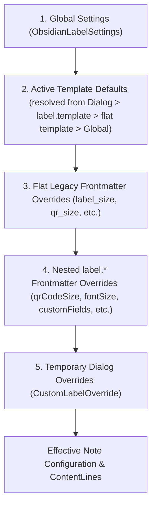

# Data Model: Per-Note Frontmatter Configuration

**Feature**: `009-frontmatter-config`  
**Date**: 2026-10-21

---

## 1. `FrontmatterLabelSchema` (Raw YAML Input)

Represents the expected structure of the `label` block inside a Markdown note's YAML frontmatter:

```yaml
---
label:
  template: "inventory"
  customFields:
    category: "Electronics"
    location: "Shelf B3"
    serial: "ABC123"
    value: "$450"
  qrCodeSize: 35
  fontSize: 14
  labelSize: "dymo-standard"
  customWidth: 89
  customHeight: 28
  qrCodePlacement: "left"
---
```

---

## 2. `ParsedFrontmatterConfig`

The sanitized, validated TypeScript representation produced by the frontmatter parser after inspecting `frontmatter`:

| Field | Type | Validation Rules | Fallback Behavior |
| :--- | :--- | :--- | :--- |
| `templateId` | `string \| undefined` | Non-empty string matching an existing built-in or custom template ID | Ignored with `console.warn` if non-string or template ID not found |
| `customFields` | `Record<string, string> \| undefined` | Plain object; scalar values (`string`, `number`, `boolean`) converted to trimmed string; empty keys or null/object values skipped with warning | `undefined` if omitted or not a plain object |
| `qrCodeSize` | `number \| undefined` | Finite number in `[10, 50]` (percentage of label dimension) | Ignored with `console.warn` if `< 10`, `> 50`, or non-numeric |
| `fontSize` | `number \| undefined` | Finite number `> 0` and `<= 72` (points) | Ignored with `console.warn` if `<= 0`, `> 72`, or non-numeric |
| `defaultLabelSize` | `LabelPresetOption \| undefined` | Must match a valid preset ID (`dymo-standard`, `brother-62mm`, `avery-5160`, `phomemo-40x30`, `generic-square-50`, `custom`) | Ignored with `console.warn` if unrecognized |
| `customWidth` | `number \| undefined` | Finite number `> 0` (mm) | Ignored with `console.warn` if `<= 0` or non-numeric |
| `customHeight` | `number \| undefined` | Finite number `> 0` (mm) | Ignored with `console.warn` if `<= 0` or non-numeric |
| `qrCodePlacement` | `QRPlacementOption \| undefined` | One of `'left' \| 'right' \| 'top' \| 'bottom'` | Ignored with `console.warn` if unrecognized |
| `warnings` | `string[]` | Diagnostic messages for each invalid field encountered during parsing | Logged via `console.warn` |

---

## 3. Configuration Resolution State Transitions



---

## 4. Custom Fields Rendering Model

- When `ParsedFrontmatterConfig.customFields` is defined (even if empty object `{}` vs populated map):
  - If populated (`Object.keys(customFields).length > 0`), each `[key, value]` entry is converted into a `ContentLine` with `type: 'custom_field'`, `label: key` (exact key casing preserved), and `text: value`, replacing the template's `contentRules.customFields` extraction.
  - Additionally, `LabelContent.customFields` is populated with `ParsedFrontmatterConfig.customFields`.
  - During canvas rendering (`renderLabelToCanvas` and `renderCustomFields`), each rendered line (`${key}: ${value}`) is measured against `maxWidth` and truncated with an ellipsis (`...`) via `truncateWithEllipsis` if its pixel width exceeds `maxWidth`.
