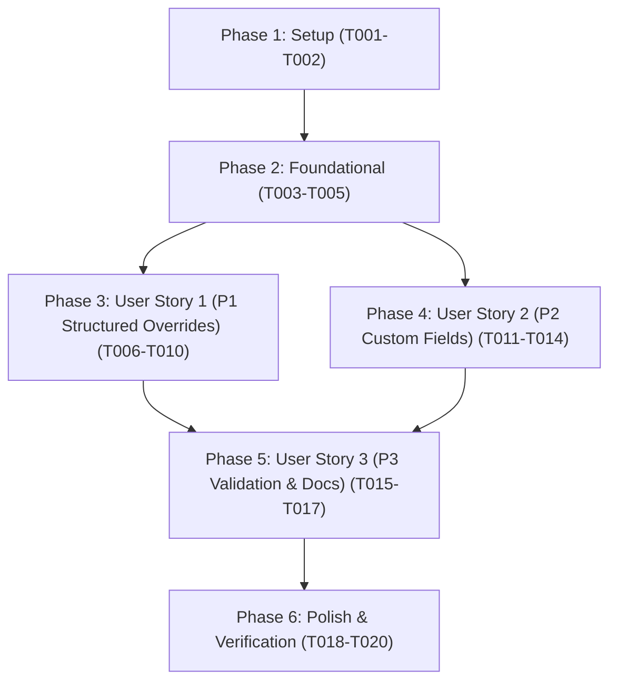

# Tasks: Per-Note Frontmatter Configuration

**Branch**: `009-frontmatter-config` | **Date**: 2026-10-21 | **Spec**: [spec.md](./spec.md) | **Plan**: [plan.md](./plan.md)

---

## Phase 1: Setup (Shared Infrastructure)

**Purpose**: Data types and frontmatter schema definitions.

- [x] T001 Create frontmatter schema and parsed configuration type definitions (`FrontmatterLabelSchema`, `ParsedFrontmatterConfig`) in src/frontmatter/types.ts
- [x] T002 [P] Extend `CustomLabelOverride` interface with optional `fontSize` and `customFields` properties in src/commands/orchestrator.ts

---

## Phase 2: Foundational (Blocking Prerequisites)

**Purpose**: Core frontmatter parser, validation logic, and warning dispatcher required by all user stories.

**⚠️ CRITICAL**: Must complete before user story implementation begins.

- [x] T003 Implement `parseFrontmatterLabelConfig` with support for nested `label.*` and legacy flat frontmatter keys in src/frontmatter/parser.ts
- [x] T004 [P] Implement field-level validation (`template`, `qrCodeSize`, `fontSize`, `labelSize`, `customWidth`, `customHeight`, `qrCodePlacement`, `customFields`) with `console.warn` diagnostics in src/frontmatter/parser.ts
- [x] T005 [P] Author foundational unit tests for `parseFrontmatterLabelConfig` in tests/unit/frontmatter-parser.test.ts

**Checkpoint**: Frontmatter parser and validation engine functional and verified by unit tests.

---

## Phase 3: User Story 1 - Structured Frontmatter Label Overrides (Priority: P1) 🎯 MVP

**Goal**: Notes can persistently specify `template`, `qrCodeSize`, `fontSize`, and dimension/layout overrides in a structured `label` frontmatter section that automatically applies during label generation while falling back to template/global settings.

**Independent Test**: Configure a note with `label: { template: "inventory", qrCodeSize: 35, fontSize: 14 }`, generate its label, and verify the effective settings and rendered PDF apply the template and overrides while preserving dialog override priority.

### Tests for User Story 1

- [x] T006 [P] [US1] Add unit tests for nested `label.*` frontmatter overrides, 5-tier precedence hierarchy, and dual-compatible `saveToFrontmatter` persistence in tests/unit/orchestrator.test.ts
- [x] T007 [P] [US1] Author end-to-end integration tests for `label.template`, `label.qrCodeSize`, `label.fontSize`, and global fallback in tests/integration/frontmatter-integration.test.ts

### Implementation for User Story 1

- [x] T008 [US1] Update `resolveEffectiveSettingsForNote` in src/commands/orchestrator.ts to integrate `parseFrontmatterLabelConfig` and apply `template`, `qrCodeSize`, `fontSize`, and dimension/placement overrides according to the 5-tier precedence hierarchy
- [x] T009 [US1] Update `saveToFrontmatter` persistence in src/commands/orchestrator.ts to write overrides into `frontmatter.label` while maintaining legacy flat key compatibility
- [x] T010 [US1] Update `generateLabelForNote` in src/commands/orchestrator.ts to ensure `effectiveSettings.fontSize` and `effectiveSettings.qrCodeSize` override template defaults when specified in `frontmatter.label`

**Checkpoint**: User Story 1 MVP fully functional and independently testable.

---

## Phase 4: User Story 2 - Custom Key-Value Fields from Frontmatter (Priority: P2)

**Goal**: Notes can define `label.customFields` key-value pairs in frontmatter that override the template's custom field lookup list, preserve exact key casing (`${key}: ${value}`), and render legibly with ellipsis truncation on the label canvas.

**Independent Test**: Configure a note with `label.customFields` containing multiple key-value pairs (including a very long value), generate the label, and verify each `key: value` line renders on the canvas with horizontal truncation and overrides the template's `contentRules.customFields`.

### Tests for User Story 2

- [x] T011 [P] [US2] Add unit and integration tests for `label.customFields` extraction, template custom field override, and `renderCustomFields` horizontal truncation in tests/unit/frontmatter-parser.test.ts and tests/integration/frontmatter-integration.test.ts

### Implementation for User Story 2

- [x] T012 [P] [US2] Implement `renderCustomFields` helper with horizontal `truncateWithEllipsis` truncation and apply line truncation to `contentLines` in src/core/canvas-renderer.ts
- [x] T013 [US2] Update `resolveContentLines` in src/templates/extractor.ts to accept optional frontmatter `customFields` map that overrides `contentRules.customFields` while preserving exact key casing (`${key}: ${value}`)
- [x] T014 [US2] Update `generateLabelForNote` in src/commands/orchestrator.ts to pass parsed `label.customFields` into `resolveContentLines` and `LabelContent.customFields`

**Checkpoint**: User Stories 1 and 2 functional and verified by unit and integration tests.

---

## Phase 5: User Story 3 - Graceful Validation & Schema Documentation (Priority: P3)

**Goal**: Malformed or out-of-range frontmatter values are ignored with descriptive console warnings while falling back to defaults, and `README.md` documents the `Per-Note Configuration` YAML frontmatter schema.

**Independent Test**: Generate labels for notes with malformed `label` blocks (non-object `label`, invalid template ID, out-of-range `qrCodeSize`, negative `fontSize`), verify generation succeeds with console warnings, and verify `README.md` contains the `Per-Note Configuration` guide.

### Tests for User Story 3

- [x] T015 [P] [US3] Expand unit tests in tests/unit/frontmatter-parser.test.ts to cover all invalid frontmatter edge cases (scalar `label`, unknown template, out-of-bounds `qrCodeSize`/`fontSize`, non-scalar `customFields`) and assert `console.warn` calls

### Implementation for User Story 3

- [x] T016 [US3] Ensure `resolvePreviewContent` in src/ui/preview-modal.ts reads per-note frontmatter overrides and `customFields` when previewing an active note
- [x] T017 [P] [US3] Add "Per-Note Configuration" documentation section with YAML examples and supported options table to README.md

**Checkpoint**: All 3 user stories complete with validation resilience and user documentation.

---

## Phase 6: Polish & Cross-Cutting Concerns

**Purpose**: Public module exports, linter checks, formatting, and full test suite verification.

- [x] T018 [P] Re-export frontmatter types (`FrontmatterLabelSchema`, `ParsedFrontmatterConfig`), `parseFrontmatterLabelConfig`, and `renderCustomFields` in src/index.ts
- [x] T019 [P] Run linter and formatting checks across all source and test files with `npm run lint` and `npm run format`
- [x] T020 Verify zero TypeScript compilation errors with `npx tsc --noEmit` and execute full test suite with `npm test`

---

## Dependencies & Execution Order

### Phase Dependencies



- **Phase 1 (Setup)**: No dependencies — can start immediately.
- **Phase 2 (Foundational)**: Depends on Phase 1; blocks all user stories.
- **Phase 3 (User Story 1 - P1 MVP)**: Depends on Phase 2; delivers persistent template, QR size, and font size overrides.
- **Phase 4 (User Story 2 - P2 Custom Fields)**: Depends on Phase 2 and integrates with US1 orchestrator flow.
- **Phase 5 (User Story 3 - P3 Validation & Docs)**: Depends on US1/US2; completes edge-case coverage, preview modal integration, and README documentation.
- **Phase 6 (Polish)**: Depends on all user stories being completed.

### Parallel Opportunities

- **Setup Phase**: `T001` and `T002` can run in parallel (different files).
- **Foundational Phase**: `T004` and `T005` can run in parallel after `T003`.
- **User Story 1**: `T006` and `T007` can be authored in parallel before `T008`–`T010`.
- **User Story 2**: `T011` and `T012` can run in parallel with `T013`.
- **User Story 3**: `T015` and `T017` can run in parallel with `T016`.
- **Polish Phase**: `T018` and `T019` can run in parallel.

---

## Parallel Example: User Story 1 & 2

```bash
# Run parallel test creation for User Story 1:
Task: "T006 [P] [US1] Add unit tests for nested label.* frontmatter overrides in tests/unit/orchestrator.test.ts"
Task: "T007 [P] [US1] Author end-to-end integration tests in tests/integration/frontmatter-integration.test.ts"

# Run parallel canvas and extractor updates for User Story 2:
Task: "T012 [P] [US2] Implement renderCustomFields helper in src/core/canvas-renderer.ts"
Task: "T013 [US2] Update resolveContentLines in src/templates/extractor.ts"
```

---

## Implementation Strategy

### MVP First (User Story 1 Only)

1. Complete **Phase 1: Setup** (`T001`–`T002`).
2. Complete **Phase 2: Foundational** (`T003`–`T005`).
3. Complete **Phase 3: User Story 1** (`T006`–`T010`).
4. **Validate MVP**: Run `npx jest tests/unit/orchestrator.test.ts tests/integration/frontmatter-integration.test.ts`.

### Incremental Delivery

1. Foundation ready (`T001`–`T005`).
2. User Story 1 delivered (`T006`–`T010`) → Persistent `label.template`, `label.qrCodeSize`, and `label.fontSize` overrides active.
3. User Story 2 delivered (`T011`–`T014`) → `label.customFields` rendering and ellipsis truncation active.
4. User Story 3 delivered (`T015`–`T017`) → Full edge-case warning coverage, preview integration, and `README.md` documentation complete.
5. Polish & Verification (`T018`–`T020`) → Public exports, clean lint/format, full test suite passing.
