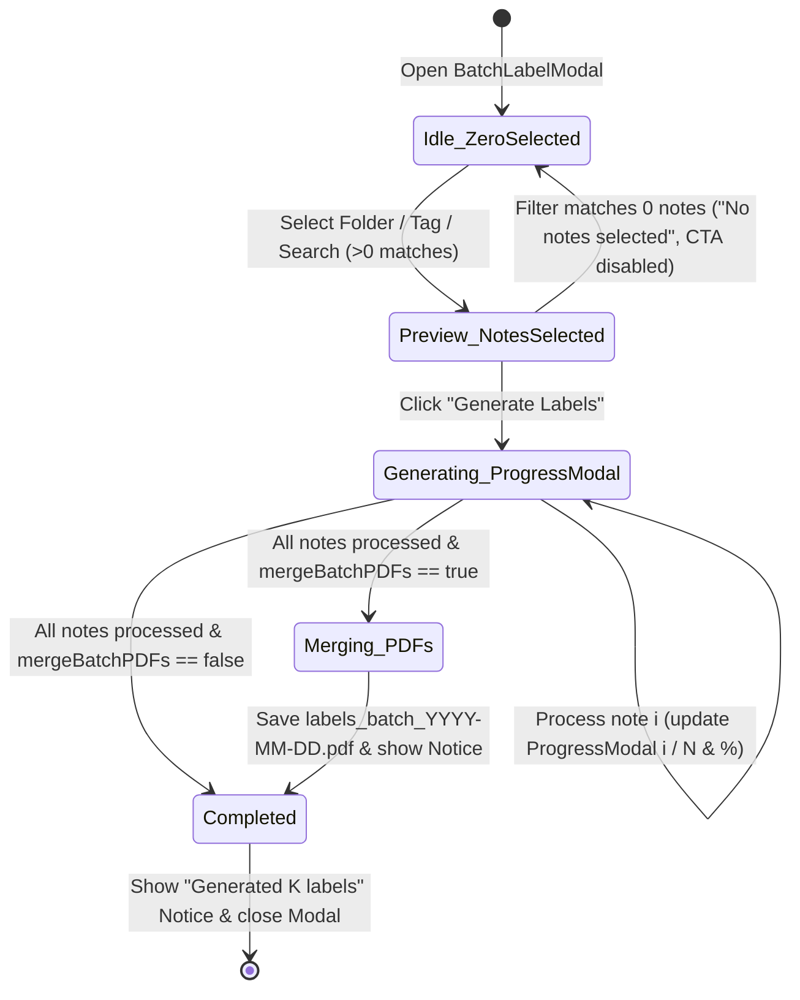

# Data Model: Batch Label Generator (`010-batch-label-generator`)

**Date**: 2026-10-21  
**Feature**: [spec.md](./spec.md)

---

## 1. Settings Extension (`src/settings/types.ts`)

```typescript
export interface ObsidianLabelSettings {
  // ... existing settings ...
  /**
   * Whether batch label generation should also merge generated PDFs
   * into a single multi-page PDF document (labels_batch_YYYY-MM-DD.pdf).
   * Default: false
   */
  mergeBatchPDFs: boolean;
}
```

- **Default Value**: `mergeBatchPDFs: false` in `DEFAULT_SETTINGS`.
- **Persistence**: Saved via `plugin.saveSettings()` in `ObsidianLabelSettingTab` and updated when toggled in `BatchLabelModal`.

---

## 2. Batch Selection Criteria (`src/commands/batch-processor.ts`)

```typescript
export type BatchSelectionMethod = 'folder' | 'tag' | 'search';

export interface BatchSelectionCriteria {
  method: BatchSelectionMethod;
  /** Folder path (e.g. '/' or 'Inventory/Tools') when method === 'folder' */
  folderPath?: string;
  /** Whether to include notes in nested subfolders when method === 'folder' (default: true) */
  includeSubfolders?: boolean;
  /** Tag filter string (with or without leading '#') when method === 'tag' */
  tag?: string;
  /** Search query matching path, title, or content when method === 'search' */
  searchQuery?: string;
}
```

### Validation & Filtering Rules
- **Exclusions**: All selection modes MUST exclude non-Markdown files and paths matching `isExcludedPath(file.path)` (hidden `.` directories and `templates`/`_templates` directories).
- **Folder Mode (`method === 'folder'`)**:
  - `includeSubfolders !== false` (default `true`): Matches all Markdown notes inside `folderPath` and its nested subdirectories (`'/'` matches all non-excluded vault Markdown notes).
  - `includeSubfolders === false`: Matches only Markdown notes whose immediate parent directory is `folderPath` (`'/'` matches only root-level Markdown notes with no `'/'` in `file.path`).
- **Tag Mode (`method === 'tag'`)**:
  - Empty/whitespace `tag` matches `0` notes (`[]`).
  - Normalizes tag by stripping leading `#` characters and lowercasing (`#Inventory` → `inventory`).
  - Inspects `metadataCache.getFileCache(file)?.tags` and `frontmatter.tags` / `frontmatter.tag`. Matches exact normalized tag or hierarchical subtag (`tag/subtag`).
- **Search Mode (`method === 'search'`)**:
  - Empty/whitespace `searchQuery` matches `0` notes (`[]`).
  - Case-insensitively matches `file.path`, `file.basename`, or note text content (via `vault.cachedRead` or `vault.adapter.read`).

---

## 3. Rendered Page Cache Entry & Merged PDF Output

```typescript
export interface BatchPageEntry {
  pdfPath: string;
  previewDataUrl?: string;
  widthMm: number;
  heightMm: number;
}
```

- **Individual PDF Retention**: Each selected note generates and retains its individual label PDF at its resolved path (`resolveLabelPDFPath`).
- **Merged PDF Output (`mergeBatchPDFs === true`)**:
  - Filename format: `labels_batch_YYYY-MM-DD.pdf` (using current UTC ISO date `new Date().toISOString().split('T')[0]`).
  - Contains `K` pages (one for each successfully generated note in the batch), preserving each page's physical dimensions (`widthMm × heightMm`) and orientation (`landscape` | `portrait`).

---

## 4. Modal State Transitions


